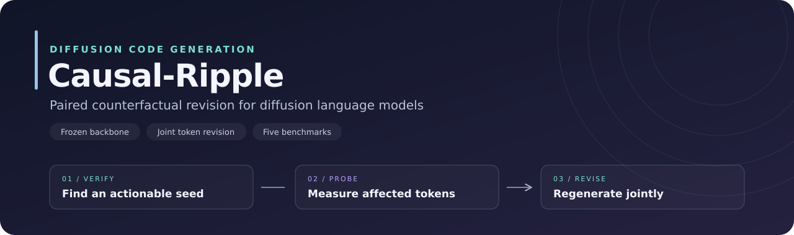
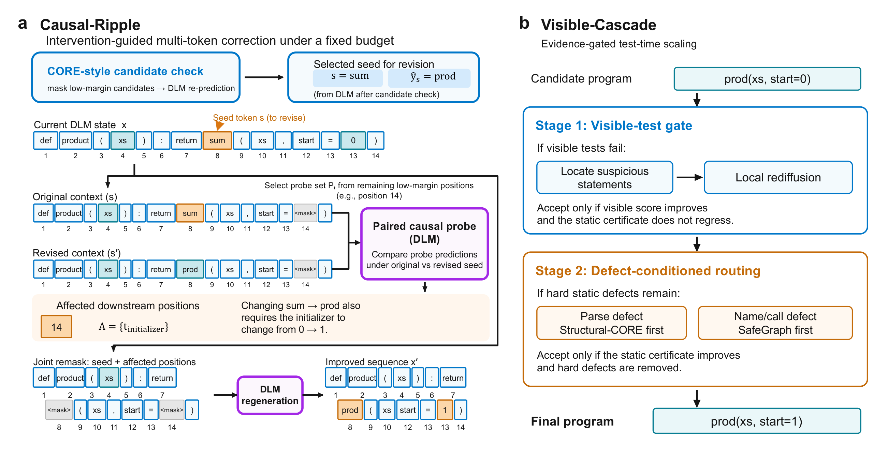
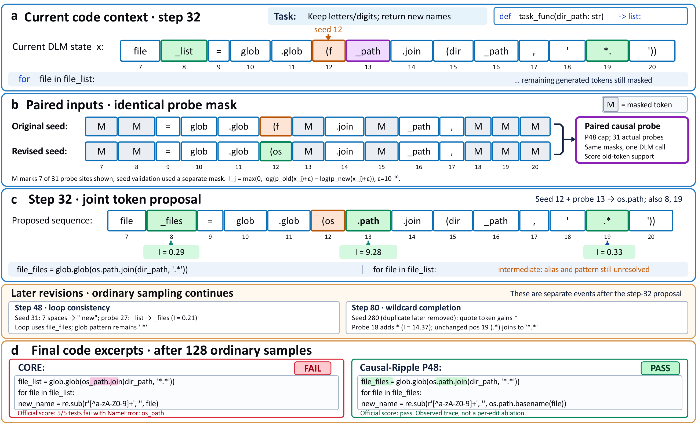

<div align="center">



**Paired Counterfactual Revision for Diffusion Language Models**

[](docs/reproduction.md)
[](https://huggingface.co/GSAI-ML/LLaDA-8B-Base)
[](LICENSE)

[Research report](REPORT.md) · [Idea catalog](docs/idea_catalog.md) · [Method](#method) · [Results](#results) · [Quick start](#quick-start) · [Reproduction](docs/reproduction.md) · [Revision case](#revision-case) · [Citation](#citation)

</div>

Causal-Ripple revises code generated by a diffusion language model by identifying tokens whose predictions change when an earlier token is corrected. A paired probe measures this influence directly; the sampler then regenerates the seed and affected tokens together.

| Frozen backbone | Compact revision | Five code benchmarks |
| :---: | :---: | :---: |
| **No weight updates** | **At most 4 tokens per event** | **HumanEval · MBPP · MBPP+ · DS-1000 · BigCodeBench** |

## Research handoff

This package contains the final selected implementation and an English research retrospective of the AutoSOTA exploration. **AutoSOTA is an automated experimentation machine** that supports idea proposal, implementation, experiment execution, and evaluation.

Start with [REPORT.md](REPORT.md) for successful and unsuccessful ideas, [the idea catalog](docs/idea_catalog.md) for candidate-level decisions, and [the evidence guide](docs/evidence.md) for provenance. Historical results are distinguished from the final five-benchmark comparison. Model weights, dataset payloads, environment caches, and repository history are not bundled.

To add this package to an existing project repository, copy this directory into the chosen project location, retain the license and notices, and commit its files. No existing repository history is required.

## Method



1. **Verify a seed.** Mask low-margin generated tokens and find an actionable correction.
2. **Measure its ripple.** Mask the same probe positions in two contexts that differ only at the seed. Compare predicted tokens and the support for their current values.
3. **Revise jointly.** Remask the seed and the strongest affected positions, then regenerate them within the ordinary token-transfer schedule.

The selected DS-1000 configuration ranks affected positions when the transfer allowance is tight. The selected BigCodeBench configuration sets a probe cap of 48 (at most 31 effective probes from 32 verified candidates) and keeps changed predictions with confidence at least 0.30. All main configurations cap joint revision at four tokens.

**Visible-Cascade** adds selective refinement: visible examples guide local rediffusion, while static certificates route programs with remaining structural defects to repair experts. It is available as a separate inference method.

## Results

Pass@1 (%) with **LLaDA-8B-Base**, greedy decoding, seed 1234, and 128 ordinary denoising steps. Bold marks Causal-Ripple; underlines mark the strongest baseline in each column. Parentheses give the relative improvement over that baseline.

| Method | HumanEval | MBPP | MBPP+ | DS-1000 | BigCodeBench |
| :--- | ---: | ---: | ---: | ---: | ---: |
| Confidence | 12.20 | 15.80 | 9.26 | 4.70 | 3.25 |
| Top-k margin | 18.90 | 21.40 | 15.61 | 5.30 | 3.68 |
| ReMDM-conf plug-in | — | — | 15.61 | <ins>5.40</ins> | 4.04 |
| Margin Remask | — | — | 17.46 | 2.60 | 3.68 |
| CORE | <ins>22.56</ins> | <ins>27.60</ins> | <ins>21.16</ins> | 4.80 | <ins>6.14</ins> |
| **Causal-Ripple** | **24.39 (+8.1%)** | **29.20 (+5.8%)** | **22.22 (+5.0%)** | **5.50 (+1.9%)** | **6.40 (+4.3%)** |
| Tasks | 164 | 500 | 378 | 1,000 | 1,140 |

The unweighted mean relative gain over the strongest listed baseline is **5.0%**. A dash denotes an unrun method–benchmark pair.

Successful-task counts and configuration details are recorded in [results/paper_results.json](results/paper_results.json). CORE uses eight verification events; Causal-Ripple uses four verification events and up to four paired-probe calls. A paired call processes two sequences, so the release records both **serial calls** and **sequence forwards**. The main sampler has a ceiling of 136 serial calls, or 140 sequence forwards.

<details>
<summary><b>Visible-Cascade: additional refinement</b></summary>

Successful tasks, comparing each cascade with its corresponding Causal-Ripple input:

| Method | HumanEval | MBPP | MBPP+ | DS-1000 | BigCodeBench |
| :--- | ---: | ---: | ---: | ---: | ---: |
| Causal-Ripple input | 40 | 146 | 84 | 52 | 73 |
| **+ Visible-Cascade** | **41** | **155** | **92** | **53** | **74** |

The DS-1000 cascade uses the `ds1000-cascade` profile with 32 verification candidates. The main-table DS-1000 result uses the selected 16-candidate `ds1000` profile and solves 55 tasks. These are separate configurations. Cascade refinement has additional inference cost, reported separately from the main sampler.

</details>

## Quick start

Use Python 3.12 and a CUDA GPU. The release replay checks used an A100 80GB.

```bash
git clone https://github.com/tsinghua-fib-lab/AutoSOTA.git
cd AutoSOTA/ai-cases/causal-ripple
python3.12 -m venv .venv
source .venv/bin/activate

pip install torch==2.11.0 --index-url https://download.pytorch.org/whl/cu128
pip install -r requirements/runtime.txt
pip install -e .
```

Prepare BigCodeBench and generate five examples:

```bash
causal-ripple-prepare --benchmark bigcodebench --output-dir data/bigcodebench

CUDA_VISIBLE_DEVICES=0 causal-ripple \
  --benchmark bigcodebench \
  --prompts data/bigcodebench/public.jsonl \
  --output outputs/bigcodebench/ripple.jsonl \
  --limit 5
```

Remove `--limit 5` to generate the full benchmark. Repeating the command resumes the same greedy run after checking its prompt, configuration, and source hashes. `public.jsonl` contains generation inputs; the separate `problems.jsonl` contains official scoring data.

For comparison, set `--method core`, `--method topk`, `--method confidence`, `--method remdm-conf`, or `--method margin-remask`. Set `--method visible-cascade` for additional refinement. `--method random` is also implemented as a simple filling baseline.

### Use the sampler directly

```python
import torch
from transformers import AutoModel, AutoTokenizer
from causal_ripple import MODEL_ID, MODEL_REVISION, generate, get_config

loader = dict(revision=MODEL_REVISION, trust_remote_code=True)
tokenizer = AutoTokenizer.from_pretrained(MODEL_ID, **loader)
model = AutoModel.from_pretrained(
    MODEL_ID, torch_dtype=torch.bfloat16, **loader
).to("cuda").eval()

prompt = tokenizer("def add(a, b):\n", return_tensors="pt").input_ids.to("cuda")
tokens, stats, _ = generate(
    model, prompt, tokenizer=tokenizer,
    steps=128, gen_length=512, block_length=512,
    remasking="ripple", config=get_config("base"),
)
print(tokenizer.decode(tokens[0, prompt.shape[1]:], skip_special_tokens=True))
```

## Reproduction

The [reproduction guide](docs/reproduction.md) provides the exact generation commands, separate official evaluation environments, historical HumanEval/MBPP harness settings, and pinned dataset versions.

| Benchmark | Profile | Verification candidates | Probes | Output tokens |
| :--- | :--- | ---: | ---: | ---: |
| HumanEval / MBPP / MBPP+ | `base` | 32 | 12 | 512 |
| DS-1000 | `ds1000` | 16 | 12 | 256 |
| BigCodeBench | `bigcodebench` | 32 | 48 | 512 |
| DS-1000 cascade input | `ds1000-cascade` | 32 | 12 | 256 |

Profiles are defined in [causal_ripple/config.py](causal_ripple/config.py); their release snapshots are in [configs/](configs/). The checkpoint is pinned to revision `0f2787f2d87eac5eed8a087d5ecd24277e6255b2`.

### Release checks

```bash
python -m unittest discover -s tests -v
```

The suite checks 36 frozen-reference sampling cases, exact token and forward-call parity, paired-context construction, and revision bounds. A100 replay checks also matched archived outputs and inference costs for the three selected profiles and a BigCodeBench cascade case. See [results/release_validation.json](results/release_validation.json) for the recorded checks. These are release compatibility checks; the main table reports the archived full-benchmark evaluations.

## Revision case



The case follows a continuous code sequence through verification, paired probing, and regeneration. Highlighted tokens show the seed correction and the related positions identified by the probe. The supplied PNG figures are retained in [assets/](assets/); duplicate PDF exports are omitted from this archive.

## Repository layout

```text
causal_ripple/
  config.py         Selected benchmark profiles
  sampling.py       Denoising and verification schedule
  revision.py       Paired influence probes and joint selection
  cascade.py        Visible-Cascade refinement
  prepare.py        Public prompts and evaluation data preparation
  run.py            Generation CLI with manifests and cost accounting
  evaluate.py       Official benchmark scoring
  lm_eval.py        HumanEval / MBPP harness integration
configs/            Frozen release profile snapshots
results/            Reported counts, provenance, and release checks
requirements/       Generation and benchmark evaluator dependencies
tests/              Sampling compatibility and mechanism tests
```

## Acknowledgments

This implementation builds on [CoRe](https://github.com/UCF-CRCV/CoRe) and uses the frozen [LLaDA](https://github.com/ML-GSAI/LLaDA) backbone. Evaluation uses [lm-evaluation-harness](https://github.com/EleutherAI/lm-evaluation-harness), [EvalPlus](https://github.com/evalplus/evalplus), [DS-1000](https://github.com/xlang-ai/DS-1000), and [BigCodeBench](https://github.com/bigcode-project/bigcodebench). Upstream credits and licenses are listed in [THIRD_PARTY_NOTICES.md](THIRD_PARTY_NOTICES.md).

## Citation

For this code release:

```bibtex
@software{causal_ripple_2026,
  author = {{Causal-Ripple contributors}},
  title = {Causal-Ripple: Paired Counterfactual Revision for Diffusion Language Models},
  year = {2026},
  url = {https://github.com/PLUTO-SCY/causal-ripple}
}
```

Released under the [MIT License](LICENSE).
