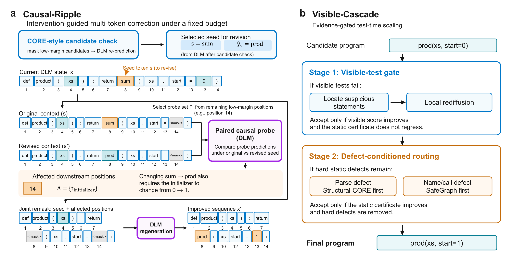
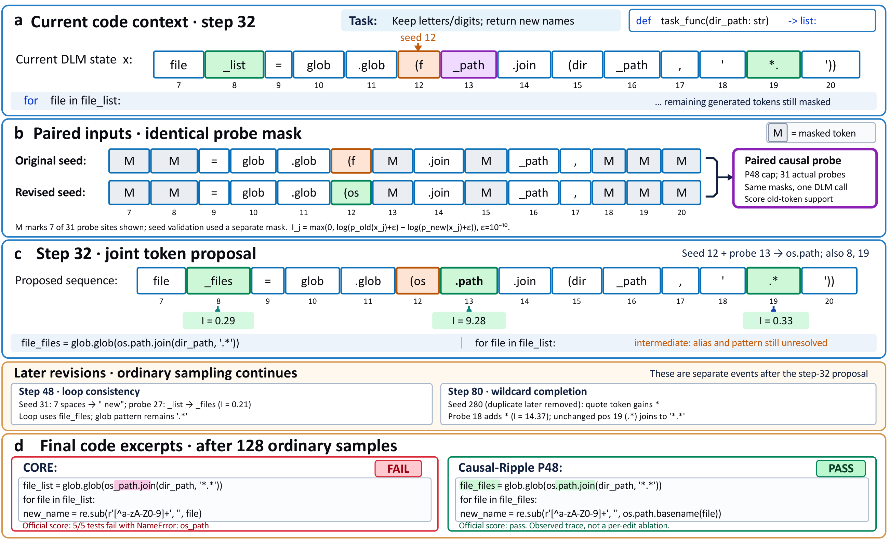

<div align="center">

# AutoSOTA Research Report
## Causal-Ripple: Paired Counterfactual Revision for Diffusion Language Models

**From baseline reproduction to coordinated token revision and diagnostic refinement**

Research record: August–October 2026 · Handoff assembled: November 7, 2026

[Selected implementation](causal_ripple/) · [Reproduction guide](docs/reproduction.md) · [Idea catalog](docs/idea_catalog.md) · [Evidence guide](docs/evidence.md) · [Final results](results/final_results.csv)

</div>

> **Executive finding.** AutoSOTA identified revision scope as an important decision in diffusion code generation. The selected Causal-Ripple configurations solve **40 / 146 / 84 / 55 / 73** tasks on HumanEval / MBPP / MBPP+ / DS-1000 / BigCodeBench. Relative to the strongest listed baseline on each benchmark, the gains are **3 / 8 / 4 / 1 / 3 tasks**, with an unweighted mean relative improvement of **5.0%**. Visible-Cascade provides a separate, more expensive refinement path. This report preserves the unsuccessful experiments and engineering lessons as well as the selected results.

## Contents

1. [Purpose, scope, and AutoSOTA's role](#1-purpose-scope-and-autosotas-role)
2. [Baseline reproduction and experimental protocol](#2-baseline-reproduction-and-experimental-protocol)
3. [The selected method](#3-the-selected-method)
4. [Exploration history and decisions](#4-exploration-history-and-decisions)
5. [Benchmark adaptation and engineering diagnosis](#5-benchmark-adaptation-and-engineering-diagnosis)
6. [Final results](#6-final-results)
7. [Mechanism evidence and a recorded case](#7-mechanism-evidence-and-a-recorded-case)
8. [What did not work and why](#8-what-did-not-work-and-why)
9. [Interesting ideas and research value](#9-interesting-ideas-and-research-value)
10. [Evidence boundaries and future experiments](#10-evidence-boundaries-and-future-experiments)
11. [Code handoff and verification](#11-code-handoff-and-verification)

## 1. Purpose, scope, and AutoSOTA's role

This handoff combines a runnable implementation of the selected methods with a retrospective of the exploration that produced them. It is intended for collaborators who need to understand the research decisions, reproduce the selected configurations, or build a successor method without repeating unsuccessful experiments.

**AutoSOTA is an automated experimentation machine.** In this project, AutoSOTA supported the proposal of candidate ideas, implementation of sampler variants, experiment scheduling, evaluation with benchmark-specific scorers, diagnosis of failures, and comparison of results. The report describes that workflow as AutoSOTA's exploration. Scientific conclusions remain grounded in the recorded experiments, and the project authors retain responsibility for their interpretation.

The experimental backbone is a frozen masked diffusion language model, LLaDA-8B-Base. The main method changes inference-time token revision rather than model weights. Code generation provides executable correctness tests and concrete examples of dependencies between tokens.

Three distinctions are used throughout:

- **Selected configuration:** a method and profile actually retained for the final comparison, not an oracle combination of different outputs.
- **Exploratory result:** a completed experiment or screening result that informed selection; the dataset may already have been inspected during development.
- **Unvalidated proposal:** an idea or interface without evidence sufficient to claim effectiveness. An implemented training interface does not imply that a predictor was trained.

“Best” in this package means the **final selected implementation for each reported protocol**. It does not mean that one configuration dominates every historical variant, that every result is statistically significant, or that these counts establish a global leaderboard record. For example, a random-probe-pool control scores one task higher than the selected MBPP+ profile while preserving its paired intervention mechanism.

## 2. Baseline reproduction and experimental protocol

### 2.1 Establishing the right baseline

AutoSOTA first reproduced confidence-based decoding and CORE-style revision. On HumanEval and MBPP, confidence filling solved 20/164 and 79/500 tasks; the initial confidence-based CORE setting reached 26/164 and 119/500. These runs established a working model and evaluation stack, but were not the final comparison setting.

AutoSOTA then aligned code experiments with **Top-k Margin filling plus CORE revision**:

| Method | HumanEval, 164 tasks | MBPP, 500 tasks | Combined correct |
|---|---:|---:|---:|
| Top-k Margin | 31 | 107 | 138 |
| CORE reproduction | 37 | 138 | 175 |
| Selected Causal-Ripple | 40 | 146 | 186 |

These are complete task sets, not screening prefixes. The change from confidence to margin filling materially changed the baseline, so results from the two settings should not be pooled. The historical evidence is indexed as **E01** in the [evidence guide](docs/evidence.md).

### 2.2 Shared generation settings

| Setting | Value |
|---|---|
| Backbone | Frozen LLaDA-8B-Base |
| Model weights | Unchanged throughout sampling and refinement |
| Ordinary denoising steps | 128 |
| Token prediction | Greedy, temperature 0 |
| Experiment seed | 1234 |
| Response length | 512 tokens; DS-1000 uses 256 |
| CORE verification interval | Every 8 steps in the middle half of generation |
| Causal-Ripple interval | Every 16 steps; events at steps 32, 48, 64, 80 |
| Joint revision cap | One seed plus at most three probes |
| Paired propagation waves | One |
| Protected positions | Prompt and final 16 response positions |

Benchmark protocols differ intentionally: HumanEval is zero-shot function completion; historical MBPP uses 500 three-shot tasks; MBPP+ uses 378 zero-shot prompts with augmented tests; DS-1000 uses 1,000 completion snippets; BigCodeBench uses all 1,140 Complete v0.1.4 tasks. The [reproduction guide](docs/reproduction.md) records exact dependency and data versions.

### 2.3 Compute accounting

A **serial call** is one invocation of the denoiser. A **sequence-forward** counts each input sequence processed by that invocation. Causal-Ripple packs the original and revised probe contexts into a batch of two.

| Configuration | Maximum serial calls | Maximum sequence-forwards |
|---|---:|---:|
| Ordinary filling | 128 | 128 |
| CORE | 128 + 8 = 136 | 136 |
| Causal-Ripple | 128 + 4 + 4 = 136 | 128 + 4 + 8 = 140 |

Actual counts can be lower when no actionable seed or probe exists. Matching the serial-call ceiling does **not** imply identical FLOPs, memory use, or elapsed time. Visible-Cascade is reported separately because it performs additional diagnosis, local regeneration, and sometimes full trajectories.

## 3. The selected method



### 3.1 Why revision scope matters

A locally plausible token can become inappropriate after another token changes. Replacing a summation operator with a product operator, for example, may also require changing an initializer. In code, a single library access can span multiple tokens, and a renamed identifier may have several uses.

CORE provides a way to identify an actionable seed correction. AutoSOTA's central idea was to ask a second question: **which other existing tokens lose support when that particular correction is made?** This separates the choice of an initial correction from the scope of the resulting update.

### 3.2 Seed verification and matched probes

At a scheduled event, the sampler masks a bounded set of low-margin filled positions. An actionable seed must receive a different proposal with confidence at least 0.30. The seed is selected by the original token's negative log-likelihood under this verification context.

Given seed position `s` and proposed replacement, the sampler constructs:

1. An original context retaining the existing seed.
2. A revised context applying only the seed replacement.

It masks the **same probe positions in both contexts**. The paired predictions therefore differ in the seed intervention rather than in which tokens are observed. The intervention score for an existing probe token is:

$$
I_i = \max\left(0,\log(p_{\mathrm{old}}(x_i)+\epsilon)-\log(p_{\mathrm{new}}(x_i)+\epsilon)\right),\qquad \epsilon=10^{-10}.
$$

A support drop of at least 0.15 or an argmax change makes a probe eligible under the base rule. Eligible probes are ranked by influence; at most three join the seed. Replacements come from revised-context predictions. “Causal” here means a controlled intervention on the model input, not identification of a causal graph of program semantics.

### 3.3 Joint action and transfer allowance

Selected positions are remasked and assigned their diagnostic proposals within the current token-transfer allowance. The ordinary schedule compensates for remasked positions, and later denoising conditions on the coordinated update.

The transfer allowance matters particularly for short outputs. With 256 response tokens and 128 ordinary steps, DS-1000 commonly has only two transfer slots per step. A proposed four-token action must therefore be truncated. The final DS-1000 configuration retains the seed and selects the additional edit by **influence rank**, rather than by sequence position.

### 3.4 Selected profiles

| Profile | Benchmarks | Verification candidates | Probe cap | Transfer truncation | Additional probe gate |
|---|---|---:|---:|---|---|
| `base` | HumanEval, MBPP, MBPP+ | 32 | 12 | Seed, then position order | None beyond the base rule |
| `ds1000` | DS-1000 main comparison | 16 | 12 | Seed, then influence | None beyond the base rule |
| `bigcodebench` | BigCodeBench | 32 | 48 nominal; 31 effective | Seed, then influence | Changed proposal and confidence ≥ 0.30 |
| `ds1000-cascade` | DS-1000 extension input | 32 | 12 | Seed, then influence | None beyond the base rule |

P48 is a configuration name indicating a nominal probe cap. With 32 verified candidates and one seed, only 31 other positions can actually be probed. It does not mean 48 calls, 48 edited tokens, or a separate model. The selected profiles are stored in [configs/](configs/) and defined in [config.py](causal_ripple/config.py).

### 3.5 Visible-Cascade

Visible-Cascade preserves the completed Causal-Ripple program as a fallback and uses additional observable evidence:

- **Local refinement:** extract assertions or simple doctests from the current public prompt, diagnose suspicious statement-like units, and locally re-diffuse candidates. Accept only a strict visible-score improvement without a worse static certificate.
- **Defect-conditioned routing:** if no local repair is accepted and a hard static defect remains, route parse defects first to Structural-CORE and name/call defects first to SafeGraph. Accept a candidate only under the applicable static-improvement rule; otherwise retain the original output.

All generators use the same frozen diffusion backbone. Hidden benchmark tests are used for final evaluation, not for candidate selection. The DS-1000 adapter supplies public setup names and required output variables; it does not execute snippets as prompt-visible tests. Observed zero-harm results on some settings are empirical findings, not a guarantee of the certificate.

## 4. Exploration history and decisions

### 4.1 The first full-set idea matrix

AutoSOTA explored five alternatives around the original revision policy. **E01** records the complete HumanEval/MBPP results.

| Candidate | Proposed mechanism | HumanEval /164 | MBPP /500 | Decision |
|---|---|---:|---:|---|
| Syntax-Closed CORE | Expand revisions around lexical/bracket structure; reserve structural repair | 40 | 142 | Useful complementary expert |
| CAUSE | An initial counterfactual repair-set variant | 37 | 134 | Not retained; weaker than CORE on MBPP |
| Causal-Ripple v1 | Bounded propagation from an actionable seed using paired probes | 40 | 146 | Selected as the main trajectory method |
| Dual-Order Consensus | Generate confidence/margin drafts, preserve agreement, regenerate conflicts | 14 | 52 | Rejected after large regressions |
| Utility Predictor proxy | Hand-designed utility from seven features | 37 | 139 | Only a marginal change; learned predictor not trained |

This comparison matters because it separates the **idea of counterfactual correction** from an effective bounded implementation. The early CAUSE variant did not succeed; the retained Causal-Ripple design did. Agreement between two drafts also did not reliably identify correctness.

### 4.2 Expanding scope through graphs and trajectory statistics

AutoSOTA next explored syntax-aware, adaptive, deeper, controlled, graph-based, and temporal extensions. Screening used 8 HumanEval and 16 MBPP tasks; development used 64 and 128 tasks. These prefixes overlap the later full evaluations and are not independent validation sets.

| Candidate | Development HumanEval /64 | Development MBPP /128 | Full HumanEval /164 | Full MBPP /500 |
|---|---:|---:|---:|---:|
| Causal-Ripple reference | 29 | 35 | 40 | 146 |
| Graph-Ripple | 27 | 36 | 37 | 148 |
| Temporal-Ripple | 28 | 30 | Not promoted | Not promoted |
| Trajectory-Graph | 28 | 30 | Not promoted | Not promoted |
| SafeGraph | 28 | 36 | 38 | 148 |
| CURE analytic proxy | 26 | 31 | Not promoted | Not promoted |

Graph-Ripple found additional MBPP solutions but lost HumanEval solutions. SafeGraph recovered one HumanEval task relative to Graph-Ripple, but its combined score merely tied Causal-Ripple at 186. Its MBPP improvements were accompanied by regressions: seven wins and five harms relative to Causal-Ripple. Local rollback could restore directly edited tokens but not necessarily undo their influence on subsequent decoding.

Other screened candidates illustrate over-caution and over-expansion. RobustGraph, AnchorGraph, and BranchGraph matched the small reference screen without new correctness gains; HoleGraph traded one win for one harm on the small MBPP screen. Deep-Ripple lost one MBPP task even in the 16-task screen. These results do not prove the whole research directions impossible; they explain why AutoSOTA did not promote those implementations.

### 4.3 Preserving complete candidates and adding evidence

The next phase moved from token-level rollback to **complete-program fallback and gated selection**. AutoSOTA explored complementary trajectories and local refinement. All results below use full HumanEval/MBPP task sets, but allow extra computation.

| Method | Mechanism | HumanEval /164 | MBPP /500 | Combined | Runtime, minutes |
|---|---|---:|---:|---:|---:|
| Causal-Ripple | Main trajectory reference | 40 | 146 | 186 | 168.1 |
| CTRP | Static-certificate routing to full trajectories | 41 | 153 | 194 | 242.0 |
| JRR | CTRP plus reconstruction tie-breaking | 41 | 153 | 194 | 242.9 |
| EGTR | Visible-example-guided local revision | 40 | 150 | 190 | 187.4 |
| ICCR | Agreement across invariant prompt views | 41 | 146 | 187 | 193.3 |
| IPMS | Multiple local candidates with original retained | 42 | 148 | 190 | 210.1 |
| PDSR | Suspicious-unit selective re-diffusion | 42 | 148 | 190 | 191.8 |
| LSCD | Latent-scaffold-guided local revision | 42 | 148 | 190 | 194.8 |
| Cascade Portfolio | Defect-specific routing with early exit | 41 | 153 | 194 | 236.4 |
| Hierarchical Portfolio | Local repair before full-trajectory routing | 42 | 152 | 194 | 251.1 |
| Visible-Cascade | Visible local repair followed by defect routing | 41 | 155 | 196 | 253.4 |

Runtime comparisons describe the recorded environment, not a hardware-independent guarantee. JRR accepted more candidates than CTRP but added no correct tasks. Cascade Portfolio preserved CTRP's correctness vector while reducing extra full trajectories from 308 to 284. Hierarchical Portfolio reduced full trajectories further to 262, but its extra local diagnosis made total runtime worse.

Visible-Cascade combined two empirically complementary signals: visible behavior and hard static defects. It yielded ten wins and zero harms relative to the original Causal-Ripple outputs across these two benchmarks. An earlier **oracle union of 197 correct tasks** used hindsight to combine branch successes; AutoSOTA did not deploy that oracle. The actual selected method achieved **196**, and that is the reported result.

### 4.4 Trying to buy repair budget by shortening denoising

AutoSOTA tested budget-neutral local search by shortening the main trajectory to fund diagnosis and repair. The total serial-call ceiling remained 136, but the primary generation process weakened.

| Candidate | HumanEval development /64 | MBPP development /128 | Reference | Outcome |
|---|---:|---:|---|---|
| BN-IPMS | 21 | 29 | 29 / 35 | Rejected before full evaluation |
| BN-PDSR | 23 | 30 | 29 / 35 | Rejected before full evaluation |
| Budget-Recycled Ripple | 3/8 on smoke | 4/16 on smoke | 3/8 and 4/16 | No new wins; not promoted |

Budget-Recycled Ripple retained all 128 ordinary steps, reduced mid-trajectory events, and reused the saved budget for late diagnosis and repair. It was less destructive in the smoke test but had no positive signal. Neither a tiny screen nor an untrained learned-selector interface was treated as full experimental success.

## 5. Benchmark adaptation and engineering diagnosis

### 5.1 Why unchanged transfer to new benchmarks was insufficient

The original Causal-Ripple profile scored **45/1,000 on DS-1000 versus CORE's 48**, **64/1,140 on BigCodeBench versus 70**, and **60/1,000 on APPS introductory versus 64**. AutoSOTA reproduced the BigCodeBench outputs across runs and checked prompt and scoring consistency. The deficit was therefore not explained by a newly introduced evaluation regression alone. See **E02–E05**.

The tasks differ operationally:

- DS-1000 inserts short snippets into a supplied namespace; the prompt and expected output-variable contract matter.
- BigCodeBench requires multi-library function completions; coupled identifiers and library-access tokens can be spread across the candidate pool.
- APPS includes input/output conventions and longer algorithmic programs, with failure modes such as repetition, empty output, and incorrect semantics that small token edits do not reliably fix.

AutoSOTA identified a concrete scheduling issue on DS-1000: the revision cap exceeded the ordinary transfer allowance, and the fallback truncation selected by token position rather than measured influence. AutoSOTA also observed that unchanged proposals sometimes consumed revision slots. Both were hypotheses to test, not automatic explanations of every failure.

### 5.2 DS-1000: transfer ranking and candidate-pool size

| Configuration | Correct /1,000 | Interpretation |
|---|---:|---|
| CORE | 48 | Main reproduced comparison |
| Original Ripple | 45 | Unadapted profile |
| Changed-proposal gate | 46 | Insufficient on its own |
| Influence-ranked transfer, 32 candidates | 52 | Retained as cascade input |
| Top-k Margin | 53 | Stronger than the 32-candidate Ripple profile |
| Ranked transfer, 16 candidates | **55** | Selected main profile |
| Probe-guard variant | 52 | Did not improve the selected direction |
| 16 candidates plus probe guard | 55 | Tied; simpler 16-candidate version retained |
| Seed-confirmation guard | 54 | Below selected main profile |
| Later ReMDM-conf plug-in baseline | 54 | Strongest final listed baseline |

The smaller verification pool preserves more context during the seed check. That is a plausible mechanism, while the measured fact is the result of the complete configured pipeline. The experiments do not establish that smaller pools are universally preferable.

An independent recheck evaluated 118 unique programs on 61 tasks covering the union of successes of the compared configurations, with no disagreements in pass flags (**E07**). AutoSOTA retained Top-k's genuine 53-task result and improved Ripple rather than altering the baseline. When the later ReMDM-conf control reached 54, the final relative gain changed from the earlier **3.8% over Top-k** to **1.9% over ReMDM-conf**.

### 5.3 BigCodeBench: increasing diagnostic coverage

| Configuration | Correct /1,140 | Decision |
|---|---:|---|
| CORE | 70 | Comparison baseline |
| Original Ripple | 64 | Insufficient transfer |
| Influence-ranked cap alone | 64 | No aggregate improvement |
| Changed, confidence-gated probes | 66 | Useful intermediate direction |
| Changed + ranked P24 | 68 | Still below CORE |
| Global-probe variant | 66 | Not retained |
| P48 | **73** | Selected |
| Probe confidence threshold 0.50 | 72 | Close, but below P48 |
| Seed-score threshold 1.25 | 66 | Not retained |
| Hard support-loss threshold 0.30 | 66 | Not retained |

P48 expands the diagnostic set without adding revision events. On the full task set it improves by five tasks over the previous P24 profile and by three over CORE. AutoSOTA independently rescored all 21 discordant tasks between P48 and CORE, covering 42 programs; every pass flag reproduced (**E06**).

This is a small measured gain: 12 wins and nine harms, an exact discordance p-value of approximately 0.664, and a paired bootstrap interval containing zero. The Hard subset remained 0/148. Those observations bound the claim; they do not erase the successful correction cases.

### 5.4 APPS and GSM8K: useful negative transfer evidence

AutoSOTA did not obtain a selected Causal-Ripple configuration exceeding CORE on APPS introductory:

| APPS configuration | Correct /1,000 |
|---|---:|
| CORE | 64 |
| Original / ranked-cap Ripple | 60 |
| Changed-proposal Ripple | 61 |
| Changed + ranked Ripple | 61 |
| Smaller joint cap, K2 | 59 |
| Later revision schedule | 59 |

These APPS settings are historical exploratory protocols; the selected release CLI does not claim to reproduce them as a supported final profile. Their result is evidence against assuming universal transfer of local token revision.

The complete 1,319-task GSM8K experiment also did not yield a strict exact-match win for the base Ripple profile (**E09**):

| Method | Strict exact match | Flexible exact match | Recorded runtime |
|---|---:|---:|---:|
| Top-k Margin | 697 | 625 | 5.93 h |
| CORE | 702 | 627 | 6.39 h |
| Causal-Ripple | 698 | 632 | 6.33 h |
| GSM8K Visible-Cascade adapter | 704 | 635 | 12.30 h |

The adapter used observable answer-format and arithmetic-consistency signals, not reference answers. The strict and flexible metrics are distinct harness outputs, not interchangeable subsets; improvements depend on the metric. Additional inference improved counts but approximately doubled recorded runtime relative to base Ripple. The final code-focused table therefore should not be read as proof of gains on general reasoning tasks.

## 6. Final results

### 6.1 Complete task counts

| Method | HumanEval /164 | MBPP /500 | MBPP+ /378 | DS-1000 /1,000 | BigCodeBench /1,140 |
|---|---:|---:|---:|---:|---:|
| Confidence | 20 | 79 | 35 | 47 | 37 |
| Top-k Margin | 31 | 107 | 59 | 53 | 42 |
| ReMDM-conf plug-in | — | — | 59 | **54** | 46 |
| Margin Remask | — | — | 66 | 26 | 42 |
| CORE | **37** | **138** | **80** | 48 | **70** |
| **Selected Causal-Ripple** | **40** | **146** | **84** | **55** | **73** |
| Additional tasks vs strongest baseline | +3 | +8 | +4 | +1 | +3 |
| Relative improvement | +8.1% | +5.8% | +5.0% | +1.9% | +4.3% |

Bold baseline cells identify the strongest baseline in each column. Dashes mean unrun pairs, not zero scores. The two later revision baselines were evaluated on all MBPP+, DS-1000, and BigCodeBench tasks; historical HumanEval/MBPP runs were not repeated for them.

For each benchmark, relative improvement is `(Ripple correct − strongest baseline correct) / strongest baseline correct`. Averaging the five unrounded relative improvements gives **5.008555%**, reported as **5.0%**. This is an equal-weight average across benchmarks, not a percentage-point increase and not a task-count-weighted aggregate.

The [machine-readable results](results/paper_results.json) include all six main methods, source-score hashes, the final comparison, and the separate Cascade inputs. [Per-task outcome vectors](results/outcomes.json) make aggregate counts and paired comparisons independently checkable without shipping benchmark test payloads.

### 6.2 Additional baseline definitions

**Margin Remask** verifies up to 32 low-margin positions and revises the position with the smallest verified top-two margin. It does not apply CORE's proposal-change/confidence gate. The schedule permits eight revision events and at most 136 sequence-forwards.

**ReMDM-conf plug-in** uses cached probability at the time a position was last decoded to sample a remasking position, with weights proportional to `exp(-cached_probability)`. It remasks before an ordinary model call and compensates the transfer schedule. It uses 128 sequence-forwards. This is the fixed-schedule LLaDA plug-in adaptation, not the original authors' standalone additional-phase sampler. Remasking is stochastic even though proposed tokens are greedy; a task-specific random stream makes resumptions reproducible.

### 6.3 Visible-Cascade results

| Benchmark | Corresponding Ripple input | Visible-Cascade | Net gain |
|---|---:|---:|---:|
| HumanEval | 40 | 41 | +1 |
| MBPP | 146 | 155 | +9 |
| MBPP+ | 84 | 92 | +8 |
| DS-1000, 32-candidate input | 52 | 53 | +1 |
| BigCodeBench, P48 input | 73 | 74 | +1 |

The DS-1000 extension uses a different input profile from the main 55-task result. **53 is an improvement over 52, not over 55.** BigCodeBench's extension has four wins and three harms, so the earlier HumanEval/MBPP zero-harm observation does not generalize to every benchmark.

Recorded mean sequence-forwards rise from 135.73 to 158.56 on MBPP+, 135.49 to 167.00 on the DS-1000 extension configuration, and 136.25 to 281.07 on BigCodeBench. The extension is evidence that observable diagnostics can improve some completed programs; it is not an overall efficiency claim.

## 7. Mechanism evidence and a recorded case

### 7.1 Complete MBPP+ controls

| Configuration | Correct /378 | Mean sequence-forwards |
|---|---:|---:|
| Top-k, 128 ordinary steps | 59 | 128.00 |
| Top-k, 136 ordinary steps | 61 | 136.00 |
| CORE | 80 | 136.00 |
| Ripple, seed only | 80 | 136.34 |
| Ripple, unpaired support | 82 | 135.65 |
| Ripple, random probe pool | **85** | 136.04 |
| Selected Ripple, paired joint | 84 | 135.73 |

The seed-only control keeps the paired-probe calls but applies only the seed edit. Its four-task deficit supports the utility of the joint action under that schedule. The unpaired control ranks revised-context support and also uses its own token-change eligibility rule; the two-task difference is not a perfectly isolated single-factor ablation.

The random-pool variant retains paired scoring and joint revision. Its 85-task result shows that the default uncertainty/locality preselection is not established as optimal. It does not remove the paired intervention mechanism. The report retains this result rather than labeling every component of the selected profile superior.

### 7.2 BigCodeBench/939



The recorded case demonstrates why a token must be interpreted in its surrounding sequence. At step 32, part of the response is:

```python
file_list = glob.glob(f_path.join(dir_path, '*.'))
```

The seed proposal changes token position 12 from `(f` to `(os`. Changing only that token would leave `os_path`, an undefined identifier. The paired probe detects strong loss of support for the adjacent `_path` token and proposes `.path`.

| Position | Existing token | Proposed token | Support loss | Selected at step 32? |
|---|---|---|---:|---|
| 12 | `(f` | `(os` | Seed | Yes |
| 13 | `_path` | `.path` | 9.2842 | Yes |
| 19 | `*.` | `.*` | 0.3320 | Yes |
| 8 | `_list` | `_files` | 0.2921 | Yes |
| 27 | `_list` | `_files` | 0.1930 | No; joint cap reached |

The step-32 proposal repairs the library access and changes identifier/pattern tokens, but is **not yet the final program**. At step 48, position 27 is updated so the loop uses `file_files`. At step 80, position 18 receives the leading wildcard while position 19 retains `.*`, yielding `'*.*'`. The step-80 seed itself is in a repeated segment later removed by deterministic cleanup. The final P48 program passes the official tests; the CORE program fails with undefined `os_path`.

The all-probe trace in [E13](evidence/E13.json) records all 31 probe positions and matches the scored output token for token. The [influence figure](assets/revision_influence_bcb939.png) visualizes both selected and unselected probes; its axis break is explicit and does not change the measured values. This is a mechanistic case study, not a claim that every correction follows this pattern.

## 8. What did not work and why

The following explanations distinguish measured behavior from plausible interpretation.

| Failure mode | Recorded observation | Lesson for a successor |
|---|---|---|
| Agreement treated as correctness | Dual-order consensus fell to 14/164 and 52/500 | Shared predictions can be consistently wrong; disagreement regeneration can discard useful context |
| Unbounded or deeper propagation | Deep-Ripple lost a task even in the small screen | Broader edits need evidence and a bounded action size |
| Instability treated as repair utility | Temporal variants fell from 35 to 30 on MBPP development | A changing prediction is not necessarily a beneficial edit |
| Static rollback treated as semantic protection | SafeGraph still had five MBPP harms relative to Ripple | Restoring edited tokens does not undo the changed trajectory |
| Confidence proxy treated as a trained selector | Analytic CURE regressed; learned heads had no independent trained weights | Preserve the distinction between heuristic proxies and learned methods |
| Main denoising traded for late search | Budget-neutral local methods regressed on development sets | Ordinary generation steps are not freely replaceable computation |
| Fewer full trajectories treated as lower total cost | Hierarchical Portfolio used fewer trajectories but more total time | Account for diagnosis and local regeneration, not just expert calls |
| Transfer cap ignored during selection | DS-1000 discarded high-influence edits under index-order truncation | Align selection with the actual per-step transfer allowance |
| More restrictive thresholds assumed safer | BigCodeBench seed/support thresholds scored 66 versus P48's 73 | Extra gates may suppress useful corrections |
| Small development gains assumed to transfer | P24 had 7 vs 5 on 96 tasks but 59 vs 65 on the other 1,044 in an earlier run | A favorable prefix is weak evidence; report complete-set outcomes |
| Local revision assumed sufficient for long programs | APPS variants remained below CORE | Investigate program-level reasoning and context/length issues separately |

AutoSOTA also encountered genuine engineering problems. An early refinement smoke run used a certificate view inconsistent with the evaluator's stop-marker truncation and was invalidated. A later development run was interrupted by loss of GPU visibility/session lifetime and was not reported as a partial accuracy result. In the additional-baseline batch, task-seed initialization was corrected to map the NumPy seed into its supported 32-bit range while retaining the task-specific random stream. Incomplete preparation directories and interrupted runs were not promoted into final result tables.

## 9. Interesting ideas and research value

### 9.1 Intervention-guided scope is the central contribution

The useful conceptual step is to measure **dependence on a proposed correction**, rather than rank each token only by its standalone uncertainty. Identical probe masks make the intervention contrast operationally clear; a bounded joint action turns that contrast into a usable inference policy.

The project supports this idea with full-task comparisons, joint-action controls, and a continuous token trace. It does not establish a first-ever priority claim against all literature or a universal guarantee that intervention scores predict functional improvement.

### 9.2 Transfer-aware selection connects the algorithm to its execution budget

The DS-1000 result shows that a policy can compute useful influence scores yet fail to use them when the transfer cap becomes binding. Ranking the surviving edits makes the executed action consistent with the diagnostic objective. This is both a practical engineering contribution and a useful design principle for other bounded iterative generators.

### 9.3 Diagnostic breadth and action size should be separate controls

BigCodeBench benefited from inspecting more candidates while still editing at most four tokens. P48 expands observation, not edit count. A promising follow-up is adaptive probe allocation that increases coverage only when the first diagnostic set is inconclusive, with sequence-level cost accounted for explicitly.

### 9.4 Complete-program fallback and observable evidence can complement token revision

The strongest extension combined visible examples with static defect routing while preserving a complete fallback program. This is more informative than assuming a local certificate makes every token edit safe. Future work could study acceptance calibration and diagnostic coverage without changing the underlying generator.

### 9.5 Promising but unvalidated directions

AutoSOTA's exploration left several research candidates rather than completed successes: independently trained repair-utility predictors; explicit benefit-versus-harm calibration; adaptive probe selection; compute-aware routing; and tests on independently held-out tasks or other diffusion backbones. The random-pool result also suggests that probe preselection deserves controlled study. These are proposed next steps, not results of this release.

## 10. Evidence boundaries and future experiments

The final results are real archived executions, but the same benchmarks were inspected repeatedly during development and selection. The selected profiles are benchmark-specific. A configuration frozen immediately before a run is not equivalent to a benchmark that has never influenced its design.

The historical paired tests also caution against equating small count differences with robust superiority: HumanEval's five wins/two harms yield an exact p-value near 0.453; MBPP's 13 wins/five harms yield about 0.096; BigCodeBench's 12/nine yield about 0.664. These describe the recorded paired comparisons, not a corrected analysis of all search decisions.

Priority follow-up experiments are:

1. Freeze the selected configurations and evaluate a genuinely unused task set or backbone.
2. Evaluate multiple sampling seeds where randomness is present; greedy tokens alone do not eliminate stochastic remasking.
3. Separate paired-versus-unpaired scoring from changes in eligibility and candidate selection.
4. Compare random, uncertainty-ranked, and adaptive probe pools under matched sequence-level compute.
5. Evaluate the extension against comparable additional-compute alternatives and report acceptance, harms, and total cost together.

No new performance experiments were launched while assembling this handoff. The recorded results extend through the additional-baseline batch completed in October 2026.

## 11. Code handoff and verification

The package contains the current selected implementation, including the later ReMDM-conf and Margin Remask controls. Runtime Python source files are copied without algorithm changes; their hashes are recorded in [selected_code_sha256.json](evidence/selected_code_sha256.json). The README and result registry have been updated to include the later baseline results and the correct 1.9% DS-1000 improvement.

| Component | Purpose |
|---|---|
| [causal_ripple/](causal_ripple/) | Sampling, paired revision, structure/certificate helpers, extension, CLI, preparation, and official scoring adapters |
| [configs/](configs/) | Selected profile snapshots |
| [requirements/](requirements/) | Generation and separate evaluation environments |
| [tests/](tests/) | Sampling parity, revision behavior, profiles, outcome counts, and later baseline controls |
| [results/](results/) | Final counts, complete per-task Boolean outcomes, analysis data, and historical validation |
| [evidence/](evidence/) | Selected receipts, trace, source hashes, and handoff verification |
| [docs/idea_catalog.md](docs/idea_catalog.md) | Candidate-by-candidate research decisions |
| [scripts/verify_results.py](scripts/verify_results.py) | Lightweight validation of counts, comparisons, and code integrity |

Run the lightweight evidence check with `python scripts/verify_results.py`. After installing the generation dependencies, run `python -m unittest discover -s tests -v`. Actual model inference requires the pinned model, appropriate hardware, and prepared benchmark data. The package preserves the existing [MIT license](LICENSE) and [third-party notices](THIRD_PARTY_NOTICES.md); it does not bundle model weights, dataset test payloads, credentials, environments, or Git history.

The [handoff validation record](evidence/handoff_validation.json) distinguishes checks executed for this package from earlier A100 compatibility replays. The latter remain historical evidence, not newly repeated full-benchmark measurements.
