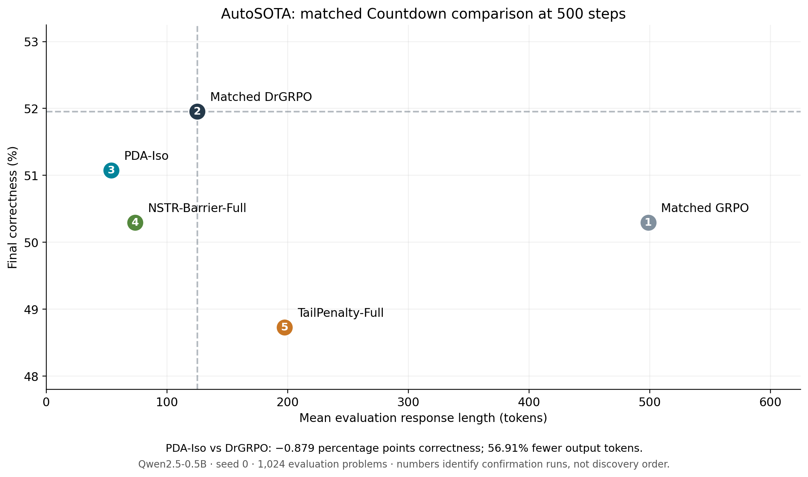

# AutoSOTA GRPO Research Report

**Semantic–protocol credit assignment for reasoning post-training**  
Research handoff · 7 November 2026 · Archived experiments through September 2026

> AutoSOTA is an automated experimentation machine. This report describes how AutoSOTA proposed, implemented, evaluated, and selected candidate mechanisms. GRPO and DrGRPO remain contributions of their original authors. This handoff reports archived measurements; it does not represent a new training campaign.

[Final results](#final-results) · [Research trajectory](#research-trajectory) · [Selected algorithm](#selected-algorithm) · [Reproduction](REPRODUCTION.md) · [Complete exploration ledger](results/exploration-ledger.csv)

## Executive assessment

AutoSOTA selected **PDA-Iso**, a Protocol-Decoupled Advantage method, as the final research contribution. It retains the correctness component of the local DrGRPO update, but distributes format credit over protocol tokens and a small tail window instead of broadcasting it across the entire response. The protocol projection has fixed mass, avoiding a format-credit budget that grows directly with response length.

There is no single winner on every objective. In the matched 500-step confirmation, **DrGRPO has the highest accuracy**, while PDA-Iso provides a substantially shorter average response and better format extraction. The selected code represents this accuracy–length trade-off, not a claim that PDA-Iso maximizes accuracy or establishes general state of the art.

## Final results

All five methods start from Qwen2.5-0.5B and use the same Countdown split, seed 0, and 500 optimizer steps. These are final validation results, not each run's best checkpoint.

| Method | Correct / 1,024 | Accuracy | Mean output tokens | Format rate | Truncation rate |
|---|---:|---:|---:|---:|---:|
| Matched GRPO | 515 | 50.29% | 498.78 | 100.00% | 46.39% |
| Matched DrGRPO | **532** | **51.95%** | 125.13 | 92.87% | 7.13% |
| **PDA-Iso — selected** | **523** | **51.07%** | **53.92** | **98.83%** | **1.17%** |
| NSTR-Barrier-Full | 515 | 50.29% | 73.79 | 100.00% | 3.32% |
| TailPenalty-Full | 499 | 48.73% | 197.57 | 85.06% | 14.94% |

Relative to DrGRPO, PDA-Iso produces **56.91% fewer output tokens**, loses **9 correct answers (0.8789 percentage points)**, improves format rate by **5.96 points**, and reduces truncation by **5.96 points**. Relative to matched GRPO, it gains 8 correct answers and reduces output length by 89.19%. The preceding GRPO-to-DrGRPO length reduction is an effect of the existing baseline and must not be credited to PDA.



Exact values and original log hashes are in [matched500.csv](results/matched500.csv). A 100-run exploration ledger is included separately; its heterogeneous budgets and initialization regimes are not one matched leaderboard.

## Task and common protocol

Countdown asks for an arithmetic expression using the provided numbers to reach a target. The verifier checks the number multiset and expression value. The reward is 1 for correctness, 0.1 for an extractable but incorrect answer, and 0 otherwise. Format rate measures the local answer-tag extraction rule, not arbitrary mathematical validity or complete syntactic correctness.

| Setting | Final confirmation protocol |
|---|---|
| Backbone | Qwen2.5-0.5B |
| Training / evaluation examples | 10,240 / 1,024 |
| Seed / optimizer steps | 0 / 500 |
| Batch size / learning rate | 256 / 1e-6 |
| Rollouts per logical question | 4: two original-view and two reordered-view responses |
| Prompt / response limit | 256 / 1,024 tokens |
| Hint policy | Adaptive, least-assisted; warmup 40; active through step 300 |
| Auxiliary supervision | Hint-token cross entropy, coefficient 0.001 |
| Evaluation | No Hint, greedy; every 25 steps and final validation |
| Checkpoint saving | Every 100 steps |

Steps 301–500 provide no Hint; the corresponding Hint supervision becomes zero. Shared settings do not imply identical realized adaptive Hint draws, because the controller observes each model's own feedback. These are matched training conditions with auxiliary supervision, not pure reinforcement learning without reference assistance. Matching optimizer steps and rollout counts is not a measurement of identical FLOPs.

## Research trajectory

### 1. Learning conditions, curricula, and semantic augmentation

AutoSOTA first investigated whether a fixed rollout budget could supply a more useful training signal. BAHA and least-assisted difficulty estimation adapted the amount of reference-prefix assistance. This became common infrastructure for later comparisons rather than the final isolated contribution.

Bi-Frontier attempted to prefer shorter responses within correct answers, avoiding a reward for short incorrect answers. Weak constraints sometimes never activated; stronger constraints introduced format costs. AutoSOTA therefore tracked activation as well as final accuracy.

Lexi and LexiGuard prioritized correctness and added tail protection. In their 125-step screen, accuracy was approximately 18.07% and 19.24%, below the same-round control's 21.09%. PAIR and PAIR+PFA introduced paired assistance or posterior-frontier structure; their 125-step accuracies were approximately 6.64% and 0%. These ideas did not become the main method.

MIRROR reordered input numbers without changing the arithmetic problem. In an early 125-step comparison, accuracy increased from 21.19% to 22.27%, but format rate fell from 96.97% to 49.71%. This was an informative failure: semantic equivalence in the task does not guarantee stable output-protocol learning.

FSA and FORGE changed frontier weighting or expanded a verifiable synthetic problem pool. TRQ, ALT, and QDA explored repetitive-tail suppression, view organization, and strategy diversity. SCASA, RAMP, and DualFormat investigated augmentation timing, balance, and format control. None established a consistently superior combined accuracy–format outcome in the archived screens. Synthetic Countdown variants were not independent new benchmarks.

### 2. From external controllers to optimization bias

In response to repeated long-output and format-instability failures, AutoSOTA actively searched the literature on GRPO normalization and adopted DrGRPO as a stronger baseline. The research contribution here was problem diagnosis and adaptation of existing work; normalization debiasing itself was not newly invented by AutoSOTA.

A MIRROR-RAMP-NHFC screen achieved approximately 22.2% accuracy and 76.8% format rate. Increasing a dynamic format coefficient alone did not eliminate drift. MIRROR-RAMP-DrGRPO achieved approximately 21.1% accuracy and 97.9% format rate; its reported 34.4-token statistic was a late-training rollout mean, not an evaluation-output mean.

Some PCASA runs looked promising despite the controller remaining inactive throughout training. AutoSOTA rejected those runs as evidence that the controller mechanism worked. HCAA amplified positive credit in difficult groups; several combinations suffered severe format degradation, including approximately 25.7% format for MIRROR-RAMP-HCAA, 32.0% for PCASA-HCAA, and 44.3% with Clip-Higher. Clip-Higher was an adaptation of an existing optimization idea, not an original foundational method.

The resulting hypothesis was specific: format failure might reflect how sequence credit is distributed, rather than merely an insufficient format reward.

### 3. Protocol-Decoupled Advantage

AutoSOTA proposed PDA to separate correctness and format residuals and give them different token projections. The first 150-step screen tested both coefficients and spatial allocation:

| Configuration | Approximate accuracy | Approximate format rate |
|---|---:|---:|
| MIRROR-RAMP-DrGRPO | 26.5% | 100.0% |
| Local PDA, format coefficient 0.8 | 22.1% | 99.5% |
| Local PDA-Iso, coefficient 0.2 | 25.6% | 99.8% |
| Global PDA, fixed mass 16, coefficient 0.8 | 26.0% | 99.4% |
| Paired PDA, coefficient 0.8 | 26.9% | 99.9% |

These values were reported with rounded source precision. Global projection outperformed local projection at coefficient 0.8 in this screen. The evidence did not justify claiming that locality alone was already proven superior. It motivated the simpler equal-coefficient decomposition and more controlled paired-view comparisons.

### 4. View-conditioned contrast and format guards

At 200 steps, paired DrGRPO reached 41.99% accuracy and 100% format. Paired PDA-Iso reached 48.44% accuracy but only 60.84% format. VCC added a within-view correctness contrast without extra rollouts: VCC-0.5 reached 35.25% / 99.22%, and VCC-1.0 reached 41.31% / 100%. VCC improved format in this screen but did not establish a higher-accuracy solution.

DualGuard used no-Hint training rollout format as feedback. In three 200-step trajectories, the Guard coefficient and gradient contribution remained zero. Differences between those runs could not be attributed to their Guard multipliers.

AutoSOTA then proposed AnchorGuard: 128 fixed training-set examples, probed greedily without Hint every 10 steps. The controller activated, but from-scratch Soft and Balanced variants reached approximately 38.96% and 31.84% accuracy, below the matched 41.99% DrGRPO result. A proposed branch that would use final validation metrics for online feedback was stopped and disabled for formal comparisons.

### 5. Warm-start repair versus fresh training

AutoSOTA explored 50-step, low-learning-rate consolidation from a selected step-200 PDA actor. Plain Repair reached approximately 54.8% and 55.8% accuracy with about 97.6% format. This was interesting but changed initialization, learning rate, optimizer state, reference state, Hint schedule, and sometimes advantage coefficients. It was not a clean test of the PDA formula alone, and its total cost was not merely 50 training steps.

A separate fresh 250-step comparison obtained:

| Method | Accuracy | Format | Evaluation tokens |
|---|---:|---:|---:|
| Paired DrGRPO | 43.65% | 95.90% | 127.60 |
| Paired PDA-Iso | 44.24% | 100.00% | 54.00 |

These are independent runs, not the step-250 checkpoints of the final 500-step trajectories. Length-frontier targets of 128/192 did not activate in some repair runs; stricter targets activated without becoming stable overall winners.

### 6. NSTR and TailPenalty

AutoSOTA hypothesized that extra format repair might be less disruptive in groups where every answer was incorrect and the centered correctness residual was zero. NSTR-Barrier restricted extra protocol credit to these groups. NSTR-Penalty removed positive Guard credit for valid-but-incorrect responses. TailPenalty retained malformed-tail penalties without requiring the all-wrong condition.

Repair experiments varied: NSTR-Barrier reached approximately 54.59% / 53.71% accuracy with 94.24% / 96.09% format; TailPenalty reached 55.37% / 54.10% accuracy with 95.31% / 87.89% format. These signals required full-training confirmation. The term null space refers to a zero current correctness residual, not an orthogonal subspace of model parameter gradients.

### 7. Long-run confirmation selected the simpler method

AutoSOTA trained the five final configurations from the same base to 500 steps. NSTR achieved perfect format extraction but lower accuracy and longer responses than PDA-Iso. TailPenalty was worse than PDA-Iso on accuracy, length, format, and truncation. The selected method therefore disables both additions, as well as VCC, Guard, and explicit length-frontier control.

The decision was not to accumulate every promising mechanism. It was to retain the simplest supported credit-allocation design after longer and more comparable evaluation.

## Selected algorithm

Let C denote correctness and F denote format validity, extracted from the existing reward R = 0.9C + 0.1F. For each logical question, compute group-centered residuals using four responses. Let M be the valid response-token mask.

The local DrGRPO implementation uses:

```text
A_Dr[i,t] = 1.8 * (C[i] - mean(C)) * M[i,t]
          + 0.2 * (F[i] - mean(F)) * M[i,t]
```

AutoSOTA's PDA-Iso changes only the format projection:

```text
A_PDA[i,t] = 1.8 * (C[i] - mean(C)) * M[i,t]
           + 0.2 * (F[i] - mean(F)) * P[i,t]
```

For format-valid responses, the projection selects exact token matches for `</think>`, `<answer>`, and `</answer>`, plus the last valid token. Invalid responses use the last at most 16 valid tokens. Valid responses with no useful tag match also fall back to that tail. For a nonempty selected set S, each selected position receives weight 16/|S|. Empty responses receive zero projection.

Both residuals are centered without division by group standard deviation. Their combined token advantage enters PPO clipping once, with ratio bounds 0.8 and 1.2. Policy loss is summed over valid tokens and divided by B×64, where B is the current microbatch size. It is not the sum of independently clipped semantic and format objectives. Common KL, entropy, and Hint-token supervision remain in the actor objective.

`Iso` means that coefficients match the decomposition of the local baseline reward. It does not mean equal total format credit or identical gradients. Fixing projection mass and changing its support happen together; a matched global-projection ablation is needed to separate their effects.

| Final setting | Value |
|---|---|
| Advantage branch | `pda_drgrpo` |
| Correctness / format scale | 1.8 / **0.2** |
| Projection | local |
| Invalid tail / projection mass | 16 / 16 |
| Loss normalization | fixed, denominator 64 |
| VCC | 0 |
| Guard / length frontier | disabled / disabled |

The historical function default for format scale is 0.8. Reproduction must use the selected runtime value **0.2**, not assume function defaults reproduce PDA-Iso.

## What remains interesting

1. **Semantic–protocol credit separation:** the main contribution changes which tokens receive each reward component, using the existing verifier rather than a new critic or extra rollout budget.
2. **Fixed-mass protocol projection:** a small interpretable credit budget can prevent long responses from accumulating format credit across unrelated reasoning tokens. Locality and mass normalization still need separate attribution.
3. **Deployment-aligned feedback:** AnchorGuard demonstrates how to check whether a training statistic reflects no-Hint behavior. Its tested recipes failed to beat the baseline, but the diagnostic principle remains useful.
4. **All-wrong-group repair:** NSTR poses a meaningful conditional-intervention question, even though the full-training result did not replace PDA-Iso.
5. **Post-training consolidation:** warm-start repair produced strong historical endpoints, but merits a separately matched study with initialization, optimizer reset, reference reset, and schedule controlled.

These are project-level research interpretations, not claims of universal priority over all published work.

## Why checkpoints and costs matter

Within the same final trajectories, PDA-Iso was ahead at step 250 (approximately 46.7% versus DrGRPO's 43.7%) but longer (122.47 versus 56.10 tokens). At step 500, the order reversed on accuracy and length. TailPenalty looked shorter at step 250 and regressed later. The shared transition away from Hint after step 300 also matters. See [matched-checkpoints.csv](results/matched-checkpoints.csv).

Mean training-step time was 83.63 s for GRPO, 72.33 s for DrGRPO, 76.54 s for PDA-Iso, 76.29 s for NSTR, and 74.19 s for TailPenalty. PDA-Iso was approximately 5.83% slower per recorded training step than DrGRPO. Output-token reduction is not equivalent to the same reduction in training time, inference latency, energy, or FLOPs.

## Evidence boundaries and final recommendation

The archived ledger contains 100 completed non-smoke runs: 81 fresh starts and 19 warm-start/repair segments. Its budgets include 125, 150, 200, 250, and 500 steps, plus 50-step repair segments. Only 24 entries have evaluation-output length. Missing length is not zero, and training rollout length must not fill those gaps. Earlier BAHA endpoints, including a 59.67% result, belong to different protocols and do not establish superiority over the matched final matrix.

The primary confirmation uses one seed and a repeatedly inspected benchmark. It establishes a measured trade-off, not statistical equivalence, independent generalization, or cross-task superiority. Average length includes incorrect and truncated responses. Archived full per-example response records for the old 500-step runs are insufficient for paired correctness-conditioned length analysis.

**Recommended handoff:** retain PDA-Iso as the selected method and matched DrGRPO as the primary accuracy baseline. Preserve the historical failures and the common Hint/SFT conditions. The next strongest validation would combine multiple seeds, an independently held-out task set, fixed-mass global/local controls, and paired response-level length measurements.

## Evidence and implementation map

- `overlay/verl/trainer/ppo/core_algos.py`: advantage construction, projection, PPO loss.
- `overlay/verl/trainer/ppo/ray_trainer.py`: branch selection and training integration.
- `overlay/verl/workers/actor/dp_actor.py`: actor updates and auxiliary objectives.
- `overlay/verl/trainer/config/ppo_trainer.yaml`: configuration schema.
- `configs/*.recorded.env`: original selected runtime settings; paths describe the historical environment.
- `results/matched500.csv`: final endpoints and original log hashes.
- `results/exploration-ledger.csv`: completed exploration snapshot.
- `results/source_manifest.json`: frozen source revision and file hashes.

This package contains the project's source overlay rather than duplicating the entire upstream distributed-training framework. Apply it to the documented upstream revision as described in the reproduction guide. Model weights, datasets, caches, credentials, raw shell logs, and checkpoints are intentionally outside the handoff.
