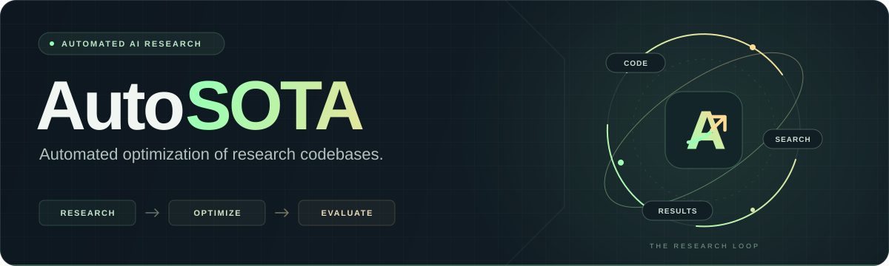
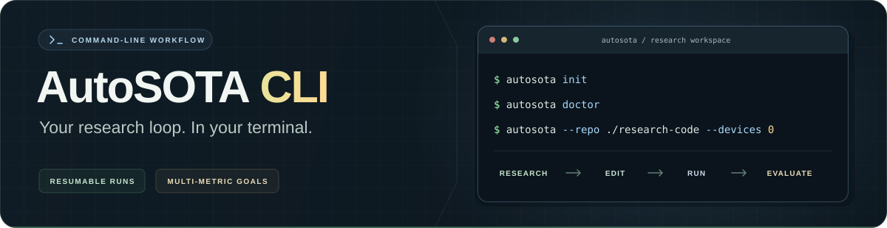

<div align="center">



<br />
<br />

Developed by **FIB LAB, Tsinghua University** and **Zhongguancun Academy**

[](../cli_guide.md) [](https://arxiv.org/abs/2604.05550) [](#experiment-results)

**[Project website](https://tsinghua-fib-lab.github.io/AutoSOTA/)** &nbsp;·&nbsp; **[Experiment results](#experiment-results)** &nbsp;·&nbsp; **[CLI guide](../cli_guide.md)** &nbsp;·&nbsp; **[Citation](#citation)**

</div>

<br />

AutoSOTA automatically explores research codebases, proposes improvements, runs experiments, and evaluates the results. This repository brings together our experiment archives and the guide to running AutoSOTA locally.

<table>
<tr>
<td width="50%" valign="top">
<h3>🧪 Explore the research</h3>
<p>Conference experiments and science benchmarks, with source code, reports, and evaluation protocols.</p>
<a href="#experiment-results"><strong>Browse experiment results →</strong></a>
</td>
<td width="50%" valign="top">
<h3>🛠️ Run AutoSOTA locally</h3>
<p>Start from a runnable research repository and an optimization goal. Let the CLI drive the research loop.</p>
<a href="../cli_guide.md"><strong>Open the CLI guide →</strong></a>
</td>
</tr>
</table>

---

<a id="experiment-results"></a>

## 🧪 Experiment Results

### Experiment News

- **2026-10-10** 🧬 Published the **ODELIA Breast MRI Challenge** study, with public-test results, code, a research report, and the complete search history.

- **2026-07-06** 🚀 Added the **ICML 2026** experiment batch, with **454 paper optimization archives** and a dashboard tracking reproduction and optimization progress.

- **2026-06-07** 👁️ Published the **CVPR 2026** experiment batch, with **51 paper optimization archives** and a conference-wide results dashboard.

- **2026-03-27** 🎉 Released our first **105 paper optimization archives** across multiple conferences, including code and experiment reports.

### Conference Experiments

| Batch | Research archive | Explore |
|:---:|:---|:---|
| **01** | **Early experiments** · 105 papers across multiple conferences | [Code & reports](../improved-papers/) · [Results](https://tsinghua-fib-lab.github.io/AutoSOTA/#papers) |
| **02** | **CVPR 2026** | [Code & reports](../CVPR-2026/) · [Dashboard](https://tsinghua-fib-lab.github.io/AutoSOTA/cvpr.html) |
| **03** | **ICML 2026** | [Code & reports](../ICML-2026/) · [Dashboard](https://tsinghua-fib-lab.github.io/AutoSOTA/icml.html) |

### Science Benchmarks

| Benchmark | Metric & evaluation | Released baseline | AutoSOTA | Improved folds | Explore |
|:---|:---|:---:|:---:|:---:|:---|
| **ODELIA Breast MRI Challenge 2025** · Medical | Challenge score · public-test-adaptive evaluation | 0.876448 | **0.899644** | **7 / 7** | [Report](../medical-benchmarks/ODELIA-AutoSOTA/docs/research_report.md) · [Code & results](../medical-benchmarks/ODELIA-AutoSOTA/) · [Search history](../medical-benchmarks/ODELIA-AutoSOTA/docs/search_history.md) |

---

<div align="center">
<a id="autosota-cli"></a>
<a href="../cli_guide.md">

</a>
</div>

## 🛠️ AutoSOTA CLI

Bring a runnable codebase and an optimization goal. **AutoSOTA CLI** iteratively researches strategies, modifies code, runs experiments, and reports the results.

| You provide | AutoSOTA runs | You receive |
|:---|:---|:---|
| Research codebase & optimization goal | Research → code → experiment → evaluate | Optimized code, patches & experiment reports |

**[Installation, configuration & usage →](../cli_guide.md)**

### CLI News

- **2026-07-27** 🔧 Released **v0.3.1** — Reduced repetitive session logs to make experiment output easier to follow.

- **2026-06-28** 🚀 Released **v0.3.0** — Added multi-agent research to the local CLI, with resumable runs, budget-driven optimization, multi-metric guardrails, literature verification, and independent final evaluation.

- **2026-05-15** 🛠️ Released **v0.2.1** — Fixed invocation failures after global installation on clean machines and added `autosota login` for one-time terms acceptance.

- **2026-05-13** 📖 Added setup instructions for **DeepSeek**, both directly and through **OpenRouter**.

- **2026-05-12** ⚡ Released **v0.2.0** — Added direct **DeepSeek** access, separate API keys for optimization and literature review, and protection against changes to evaluation scripts.

- **2026-04-29** 🎛️ Released **v0.1.1** — Added inter-round pauses with `-i` and the interactive commands `ask`, `steer`, and `sessions`.

- **2026-04-22** 🎉 Released **v0.1.0** — The first CLI release supports codebase exploration, literature review, iterative experiments, and code and patch export.

- **2026-04-21** 💻 Initialized the AutoSOTA CLI project on our lab server.

### Latest release

**v0.3.1 · July 27, 2026**

Session output stays readable even when a backend continuously emits status events. The CLI now prints the `[session]` start message once per session, while keeping retry and error notices visible so you can follow the experiment and spot problems.

---

## ⭐ Star History

<details>
<summary><strong>See how the community is growing</strong></summary>

[](https://star-history.com/#tsinghua-fib-lab/AutoSOTA&Date)

</details>

---

<a id="citation"></a>

## 📝 Citation

If you find AutoSOTA useful for your research, please cite:

```bibtex
@article{li2026autosota,
  title={Autosota: An end-to-end automated research system for state-of-the-art ai model discovery},
  author={Li, Yu and Shao, Chenyang and Liu, Xinyang and Zhao, Ruotong and Liu, Peijie and Su, Hongyuan and Chen, Zhibin and Yang, Qinglong and Xu, Anjie and Fang, Yi and others},
  journal={arXiv preprint arXiv:2604.05550},
  year={2026}
}
```
