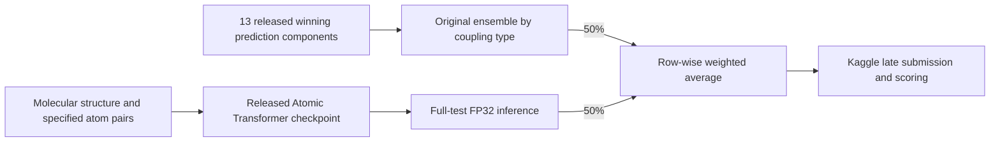

# CHAMPS: Predicting Molecular Properties — AutoSOTA research report

> Source-only GitHub archive prepared on November 9, 2026. This English text is retained from the supplied report. Historical paths and artifact-retention statements describe the original experiment environment. Data, checkpoints, fitted parameter files, predictions, logs, and raw evidence tables are external to this archive. No new experiment or Kaggle submission was run during integration.

Experiment date: October 10, 2026  
Report preparation and historical leaderboard verification: October 23, 2026  
Working directory: `/home/dataset-assist-0/scy/0-Kaggle-C04`

autosota reproduced the winning ensemble from its publicly released component predictions, ran the runner-up's released single-model checkpoint on the full test set, and proposed and evaluated fixed-weight blends of the two outputs. The best candidate assigned **50% to the winning ensemble and 50% to the runner-up's single model**. Kaggle returned a **public leaderboard score of −3.32551 and a private leaderboard score of −3.32019**. Against the winning-ensemble control resubmitted in this experiment, this represents an approximately **7.83% reduction in the geometric mean of the MAEs across the eight scalar coupling types**.

These scores are lower than the historical winning scores, but they were obtained through late submissions. **autosota improved upon the resubmitted winning control without changing the official historical standings.** No models were trained from scratch in this experiment. For the winner, reproduction covered ensembling the released predictions; for the runner-up, it covered full-test inference from a released checkpoint.

### 1. Task Definition and Description

#### 1.1 Problem context

The Kaggle competition [Predicting Molecular Properties, also referred to as CHAMPS Scalar Coupling](https://www.kaggle.com/competitions/champs-scalar-coupling), is a molecular property regression task. Given a molecule's three-dimensional structure and specified atom pairs, the objective is to predict each pair's scalar coupling constant, `scalar_coupling_constant`, in Hz. This quantity describes a magnetic interaction relevant to nuclear magnetic resonance (NMR), influenced by molecular geometry and chemical connectivity.

Each prediction corresponds to a specified atom pair. A molecule can therefore contribute multiple prediction targets.

#### 1.2 Inputs and outputs

| Data | Main fields | Purpose |
| --- | --- | --- |
| `train.csv` | `id`, `molecule_name`, `atom_index_0`, `atom_index_1`, `type`, `scalar_coupling_constant` | Labeled training pairs |
| `test.csv` | The corresponding pair-identification fields, without the target | Pairs requiring predictions |
| `structures.csv` | `molecule_name`, `atom_index`, `atom`, `x`, `y`, `z` | Element identities and three-dimensional atomic coordinates |
| Submission file | `id,scalar_coupling_constant` | One predicted value per test pair |

The eight scalar coupling types are `1JHC`, `1JHN`, `2JHC`, `2JHH`, `2JHN`, `3JHC`, `3JHH`, and `3JHN`. The leading number specifies the number of bonds separating the coupled atoms.

The successfully scored submissions used the organizer's archived masked test inputs. This archive contains **4,658,147 training pairs**, **2,505,542 test pairs**, and **130,775 molecules** in total. Its elements are C, H, N, O, and F, with at most 29 atoms per molecule. The archived training and test molecule sets are disjoint. These counts come from the local data audit (external reference: `research/data_audit.json`).

#### 1.3 Evaluation metric

Kaggle's evaluation description uses the term **Log of the Mean Absolute Error**, computed for each scalar coupling type and then averaged across types. We refer to this score as the **mean of the per-type log MAEs**: compute the MAE separately for each type, take its natural logarithm, and average equally across types.

$$
\operatorname{MAE}_t=\frac{1}{N_t}\sum_{i\in t}|y_i-\hat y_i|,
\qquad
S=\frac{1}{8}\sum_{t=1}^{8}\ln\left(\max(\operatorname{MAE}_t,10^{-9})\right).
$$

**Lower is better.** Each type receives equal weight, so less frequent types still affect the score substantially. A single MAE pooled over all observations is a different metric. [Official evaluation description](https://www.kaggle.com/competitions/champs-scalar-coupling/overview/evaluation)

### 2. Exploration Process

#### 2.1 Selecting strong public solutions with reproducible resources

autosota investigated the competition leaderboards, solution write-ups, GitHub repositories, and the organizer's public archives. Candidates were selected based on official competition performance, availability of code and weights, and whether their released resources could be verified locally. Two approaches were selected:

| Approach | Historical team and rank | Public resources | Scope completed in this experiment |
| --- | --- | --- | --- |
| Graph Transformer ensemble | hybrid / Bosch, official 1st place | Preprocessing, training and inference code; 13 model checkpoints and component predictions | Re-executed the original ensemble and verified strict loading of all 13 checkpoints |
| Atomic Transformer | Quantum Uncertainty, official 2nd place | Original notebook and a released single-model checkpoint | Adapted the runtime and completed full-test inference |

Sources: [winning solution repository](https://github.com/boschresearch/BCAI_kaggle_CHAMPS), [runner-up repository](https://github.com/antorsae/champs-scalar-coupling), and [runner-up solution write-up](https://www.kaggle.com/competitions/champs-scalar-coupling/writeups/quantum-uncertainty-2-solution-quantum-uncertainty).

The organizer's [champs_kaggle repository](https://github.com/larsbratholm/champs_kaggle) collects solutions from the teams ranked 1–5 and 12, along with archived research resources. This experiment used publicly accessible resources. It did not have access to every participant's private code, private notebooks, or complete submission history.

#### 2.2 Setting up the environment and verifying the winning ensemble

The winning project provides a fast reproduction path using precomputed predictions. The original source was retained, with NumPy compatibility and path adjustments placed in a separate wrapper. The original `ensemble()` function was rerun: for each scalar coupling type, the original configuration selects nine models, sorts their predictions for each pair, and averages the middle five values.

Verification established that:

- The original ensembling procedure used the 13 released prediction components and produced predictions for all 2,505,542 test IDs.
- The maximum absolute difference from the released final prediction file was **8.53 × 10⁻¹⁴**; every difference was below `1e-12`.
- All 13 checkpoints passed strict loading through the original model loader.

This verifies the reproduced ensemble output and checkpoint loadability. The experiment did not rerun all 13 winning networks from raw molecular geometry or retrain them. Evidence: ensemble verification (external reference: `artifacts/champion_fast_verification.json`) and checkpoint verification (external reference: `artifacts/champion_checkpoint_verification.json`).

#### 2.3 Adapting the runner-up's single model and running full-test inference

The runner-up's representation creates an input for each source atom and translates the whole molecule so that this source atom lies at the origin. Atomic coordinates, element identities, and coupling types are then supplied to an Atomic Transformer. This experiment loaded the released `loss-5.6396.pth` checkpoint, containing **82,014,746 parameters**, with a strict match for all 118 state tensors.

Adaptation reused the original notebook's model definitions, supplied the required FastAI helper layers, preserved the original type ordering and coordinate normalization, retained the reversed-pair context and padding to 29 atoms, and addressed compatibility issues such as hard-coded device placement. Inference used FP32 with TF32 disabled.

A comparison against the original notebook preprocessing covered 32 molecules and 504 source-centered groups. Coordinates, element identities, type indices, and original pair IDs matched exactly. Full-test inference was then completed using **three GPU shards**. Evidence: preprocessing verification (external reference: `artifacts/atomic_preprocessing_verification.json`), checkpoint verification (external reference: `artifacts/runnerup_checkpoint/verification.json`), and full-test inference verification (external reference: `artifacts/atomic_inference/test_verification.json`).

This experiment used one released runner-up model. The runner-up's historical second-place score came from its full ensemble of 14 models and must not be attributed to this single checkpoint.

#### 2.4 Diagnosing a mismatch between downloadable inputs and the scoring backend

After account login, the files downloadable from Kaggle were compared with the organizer's archive. The molecule splits and IDs differed:

| Item | Kaggle files downloaded during the experiment | Organizer archive |
| --- | ---: | ---: |
| Training pairs | 4,659,076 | 4,658,147 |
| Test pairs | 2,505,190 | 2,505,542 |
| Rows in the structures table | 2,358,875 | 2,358,657 |

To determine which inputs the scoring backend expected, a separate full inference run was performed on the test file then downloadable from Kaggle. Its submission passed local checks against those inputs but failed scoring with the explicit error:

```text
Evaluation Exception: Submission must have 2505542 rows
```

In contrast, the winning control, runner-up model, and all three blends using the organizer's archive format completed scoring. The reported results therefore use the **2,505,542-row archived test format** accepted by the backend in this experiment. The failed diagnostic submission has no valid score and is excluded from the successful experiments. Evidence: file comparison (external reference: `research/input_version_audit/primary_data_comparison.json`), pair-key alignment audit (external reference: `research/input_version_audit/key_alignment_audit.json`), and submission error record (external reference: `artifacts/kaggle_scoring/submission_errors.json`).

The two splits must be kept separate: 29,715 molecules in the Kaggle training download also occur in the archived test set. Any future training should first establish a split consistent with the scoring backend. This experiment used released weights and predictions; it did not use those overlapping labels to train new models or fit blend weights.

#### 2.5 Creating a small set of fixed blends and submitting controls

Before obtaining any Kaggle scores in this experiment, three candidates were generated with winner/runner-up weights of **90/10, 75/25, and 50/50**. The winning control, the runner-up single model, and all three blends were then submitted to the same scoring backend.

All three blends improved on the winning control, with 50/50 performing best. Download, submission, and scoring access were verified using the user's own OAuth-authenticated account.

#### 2.6 autosota idea and experiment register

The table distinguishes experiments autosota actually ran, verification-only work, and directions that were reviewed or reserved for future work. Directions without results are not counted as successful experiments.

| ID | Investigation / idea led by autosota | Status and result |
| --- | --- | --- |
| I01 | Establish a reproducible winning control rather than substituting historical scores for a current control | Executed: maximum difference from released winning predictions 8.53 × 10⁻¹⁴; public −3.24435, private −3.23869 |
| I02 | Check whether all winning checkpoints could support later inference from molecular structure | Verified: all 13 checkpoints loaded strictly; full inference through all 13 networks and retraining were not performed |
| I03 | Introduce the structurally different runner-up Atomic Transformer as a second prediction route | Executed: one released checkpoint completed full-test inference; public −3.16408, private −3.16083 |
| I04 | Preserve original preprocessing while reducing reproduction overhead through vectorization, memory mapping, and three GPU shards | Implemented: matched the notebook on 32 molecules and 504 groups; shard times 56.1, 55.8, 55.9 seconds; no separate accuracy ablation |
| I05 | Add 10% runner-up predictions as a conservative test of complementarity | Executed: 90/10 blend, public −3.28028, private −3.27464 |
| I06 | Increase runner-up weight to 25% to test a stronger blend | Executed: 75/25 blend, public −3.31740, private −3.31165 |
| I07 | Allocate half the weight to each prediction route | Executed, selected best: 50/50 blend, public −3.32551, private −3.32019 |
| I08 | Run inference on the test inputs downloaded after login to diagnose input versions | Diagnostic executed: another full inference run; submission 57036963 failed scoring with a requirement for 2,505,542 rows and has no valid score |
| I09 | Check whether shifting IDs or remapping pair keys could make the two splits interchangeable | Audited: only 879,177 pair keys matched; 1,626,013 did not; cross-split molecule overlap prevented mixing training data |
| I10 | Prepare a strict molecule-level holdout before training or fine-tuning new models | Holdout mask prepared for future training; no new training, OOF predictions, or independent validation score |
| I11 | Review rotations / TTA, multi-task learning, dropout, and lower-precision training reported upstream | Literature review only; these ablations were not run in this experiment and upstream results are not claimed as autosota experiments |
| I12 | Review the organizer's meta-ensemble that fits weights using part of the test labels | Reviewed and not adopted; this experiment's fixed weights neither read hidden targets nor reuse label-supervised weights |

The three candidates in I05–I07 were generated before any leaderboard score was obtained in this experiment. Evidence paths and experiment references are recorded in the autosota investigation and experiment journal (external reference: `research/autosota_experiment_journal.md`).

### 3. Final Successful Optimization Method

#### 3.1 Linear blending of the two solution outputs

Let $\hat y_{\mathrm{winner}}$ denote the output of the original winning ensemble and $\hat y_{\mathrm{atomic}}$ the output of the released runner-up single model. The final prediction is:

$$
\hat y_{\mathrm{final}}=0.5\hat y_{\mathrm{winner}}+0.5\hat y_{\mathrm{atomic}}.
$$

**Half of the final weight is assigned to the winning ensemble as a whole; the other half is assigned to the runner-up's single model.** The implementation verifies matching IDs, ordering, row counts, and finite values before averaging the predictions row by row and writing the submission file.



The results demonstrate a benefit from combining the two structurally different approaches. Although the runner-up's single model scored worse on its own, blending its predictions with the winning ensemble improved the final score. The gains across the three fixed candidates are consistent with complementary prediction errors; hidden test labels were not used to calculate per-observation error correlations.

Implementation: [scripts/blend_candidates.py](scripts/blend_candidates.py). Selected file and weights: [artifacts/best_submission.json](artifacts/best_submission.json).

#### 3.2 Scope of the result

The hidden test targets in the organizer's archive were neither extracted nor read, and were not used to fit weights. Candidate weights were fixed before submission; the final candidate was selected using the returned scores. Because this was a post-competition experiment with private scores visible, the private-score comparison is not an additional, untouched blind evaluation.

The released checkpoint had already been trained on the original training data, so its training-sample smoke-check score cannot establish a generalization improvement. The performance claims in this report rely on actual Kaggle scoring. No new out-of-fold (OOF) predictions were generated, no new models were trained, and the runner-up's complete 14-model ensemble was not reproduced.

#### 3.3 Standalone specification of the selected method

autosota selected one final blending parameter: runner-up weight `alpha = 0.5`, with winning-ensemble weight `1 - alpha`. The complete recipe is:

1. Obtain the winning output by applying the original per-type selection and middle-five averaging procedure to its 13 released prediction components.
2. Run the released runner-up checkpoint over the full test set in FP32, retaining the original type order, source centering, reversed-pair context, and padding rules.
3. Check column names, row count, unique IDs, row order, and finite predictions in both CSVs. The successfully scored format contains 2,505,542 rows.
4. Blend row by row using `0.5 * winner + 0.5 * atomic` and serialize predictions using `%.10g`.
5. Match the resulting SHA256 to submission 57036892, tying the implementation to the file that actually scored private −3.32019.

This code-and-report-only release includes no weights, datasets, prediction CSVs, or caches. `reproduce_best.py` accepts externally supplied component predictions through `--winner` and `--atomic` and rebuilds and verifies the blend without running the models. Model-inference and public-resource retrieval code are retained. See the standalone [BEST_METHOD.md](README.md#method).

### 4. Performance and Improvement

#### 4.1 Public and private scores compared with the official top three

The historical public and private scores of the top three teams were verified separately through the Kaggle API on **October 23, 2026**. The proposed method's scores came from a late submission completed on October 10, 2026. Lower is better for every score below.

| Official historical rank | Team / method | Public | Private | Score provenance |
| --- | --- | ---: | ---: | --- |
| 1 | hybrid / Bosch | −3.24530 | −3.23968 | Historical official result |
| 2 | Quantum Uncertainty | −3.23008 | −3.22349 | Historical official result, full ensemble |
| 3 | [ka.kr] Solve chem. together | −3.19825 | −3.19498 | Historical official result |
| Late submission; no new official rank | **This method: 50/50 winner/runner-up blend** | **−3.32551** | **−3.32019** | **Completed Kaggle scoring in this experiment** |

The proposed method's public and private scores are lower than the historical winner's scores by **0.08021** and **0.08051**, respectively. The corresponding differences are **0.09543 / 0.09670** against historical second place and **0.12726 / 0.12521** against historical third place.

The historical and present scoring configurations cannot be assumed to be identical. Resubmitting the reproduced winning predictions yielded scores that differ slightly from the historical record. For quantifying this experiment's improvement, the control resubmitted to the same backend is therefore the stronger comparison. Sources: [Kaggle leaderboard](https://www.kaggle.com/competitions/champs-scalar-coupling/leaderboard) and the saved public/private leaderboard verification (external reference: `research/report_leaderboard_verification_2026-10-23.json`).

#### 4.2 Controls and blend ablation in this experiment

All entries below used the same archived test format and the same Kaggle late-submission scoring backend. All have status `SubmissionStatus.COMPLETE`.

| Method in this experiment | Winner weight | Runner-up single-model weight | Public | Private | Kaggle submission reference |
| --- | ---: | ---: | ---: | ---: | ---: |
| Reproduced winning-ensemble control | 100% | 0% | −3.24435 | −3.23869 | 57036608 |
| Released runner-up single model | 0% | 100% | −3.16408 | −3.16083 | 57037095 |
| Fixed blend 90/10 | 90% | 10% | −3.28028 | −3.27464 | 57036916 |
| Fixed blend 75/25 | 75% | 25% | −3.31740 | −3.31165 | 57036825 |
| **Fixed blend 50/50** | **50%** | **50%** | **−3.32551** | **−3.32019** | **57036892** |

The raw API results and hashes linking scores to submission files are saved in [artifacts/kaggle_scoring/latest.json](artifacts/kaggle_scoring/latest.json).

#### 4.3 Interpreting the 7.83% improvement

Because the score averages the logarithms of the per-type MAEs, $\exp(S)$ is their geometric mean, with the metric's floor applied. Relative reduction against the resubmitted winning control is:

$$
1-\exp(S_{\mathrm{final}}-S_{\mathrm{control}}).
$$

| Comparison | Public | Private |
| --- | ---: | ---: |
| Winning control score | −3.24435 | −3.23869 |
| Best blend score | −3.32551 | −3.32019 |
| Score reduction | 0.08116 | 0.08150 |
| Relative reduction in geometric mean MAE across types | **7.80%** | **7.83%** |

These percentages refer to the geometric mean of the eight per-type MAEs, not an arithmetic MAE pooled over all test observations.

### 5. Experimental Setup and Resources

#### 5.1 Hardware and software

| Item | Configuration used in this experiment |
| --- | --- |
| GPUs available on the machine | **4 × NVIDIA A100-SXM4-80GB**, 80 GB per GPU |
| GPUs used for the main full-test inference | **3 GPUs**, devices 1, 2, and 3, with one independent shard per device |
| CPU / memory | 128 logical CPUs and approximately 1 TB of RAM |
| Main operations | Public-resource downloads, preprocessing, checkpoint verification, inference, ensembling, and submission scoring |
| Additional training | No training from scratch or fine-tuning in this experiment |
| Numerical precision | FP32 for runner-up inference; TF32 disabled |
| Inference batch size | Default of 512 source-centered input groups per shard |
| Inference environment | Python 3.8, PyTorch 2.1.2 / CUDA 12.1, NumPy 1.24.3, pandas 1.5.3 |
| Other dependencies | scikit-learn 1.3.2, RDKit 2024.3.5, Open Babel 3.1.1.22, among others |
| Authentication and submission environment | Separate Python 3.12.13 environment, Kaggle CLI 2.2.4, SDK 0.1.37 |

Complete versions are saved in the inference environment freeze (external reference: `research/environment_freeze.txt`) and Kaggle CLI environment freeze (external reference: `research/kaggle_cli_environment_freeze.txt`). Four GPUs describe machine capacity; three describe the parallel GPU usage of the main inference run.

#### 5.2 Base predictive models and checkpoints

| Component | Model / resource | Parameters and use in this experiment |
| --- | --- | --- |
| Winning base solution | Original ensemble of 13 Graph Transformers | Approximately 84.2M–191.7M parameters per model; released predictions were ensembled and all checkpoints were verified by strict loading |
| Runner-up base model | Atomic Transformer, `loss-5.6396.pth` | 82,014,746 parameters; released weights used for full-test inference |
| Final predictor | 50/50 linear blend of the two outputs | No additional trainable parameters |
| Investigation and experiment lead | autosota | Led exploration, code adaptation, fixed-blend ideas, experiments, and analysis |

The predictive base models are publicly released weights trained for molecular prediction; autosota built and evaluated the blending method on their outputs.

Pinned source versions, also saved in repository_commits.json (external reference: `research/repository_commits.json`):

| Repository | Commit |
| --- | --- |
| Bosch winning solution | `4a42e18b5b88043fb40ec15289216a1d88789698` |
| Atomic Transformer | `d9fd867b8ce60faa129ea004966fe5baaf8a8099` |
| Organizer's solution collection | `fda4f213d02fd5e0138a86c52b4140c9f94fec6e` |

#### 5.3 Runtime records

The following timings come from the original execution logs. Inference was not rerun to prepare this report.

| Stage | Recorded duration | Interpretation and source |
| --- | ---: | --- |
| Runner-up preprocessing of archived training inputs | 26.58 seconds | prepare_atomic.log (external reference: `logs/prepare_atomic.log`); input preparation and original normalization, not model training |
| Runner-up preprocessing of archived test inputs | 13.61 seconds | Same log |
| Test inference, shard 0 | 56.1 seconds | atomic_test_shard0.log (external reference: `logs/atomic_test_shard0.log`) |
| Test inference, shard 1 | 55.8 seconds | atomic_test_shard1.log (external reference: `logs/atomic_test_shard1.log`) |
| Test inference, shard 2 | 55.9 seconds | atomic_test_shard2.log (external reference: `logs/atomic_test_shard2.log`) |
| Parallel inference stage on three GPUs | Approximately 56 seconds | Estimated from the slowest shard; not end-to-end runtime |
| Winning ensemble, downloads, environment setup, and complete workflow | No single complete timing record | The approximately 56-second inference stage is not the total project duration |

The shard timer begins at the inference loop after model loading and output-buffer creation. It includes input construction, data transfers, and prediction writes inside that loop. It excludes process startup, model loading, earlier preprocessing, shard combination, CSV output, and Kaggle queueing and scoring.

Existing file timestamps span approximately **11:31–16:48 on October 10, 2026**, or **5 hours 17 minutes**, in Beijing time (UTC+8). This is the span covered by the available installation and score-fetching logs. It includes research, downloads, adaptation, waiting for account authorization, and submission checks; it is neither a precise measurement of the full project duration nor a measure of continuous GPU activity.

The best candidate CSV had been generated by approximately **12:14**. The first winning-control submission was made at approximately **16:26**, and the best blend was submitted at approximately **16:37**. These records also show a substantial interval outside active computation. Original API timestamps are in UTC; the timeline here is converted to UTC+8.

#### 5.4 Token usage and measurement boundaries

| Usage item | What can be reported |
| --- | --- |
| Text tokens for molecular-model inference | Not applicable; inputs are numerical coordinates and categorical tensors |
| autosota input tokens for research, coding, and tool use | Not recorded; no reliable total available |
| autosota output / reasoning tokens | Not recorded; no reliable total available |
| Cached tokens and cumulative API cost | Not recorded; no reliable total available |

The project did not retain a complete session token-usage record or billing export. Accordingly, this report does not estimate those numbers or treat missing records as zero. Future comparisons of automated optimization cases should record model versions, usage per call, start and end timestamps, and GPU usage from the beginning of each task.

### 6. Artifacts and Reproduction Entry Points

| Artifact | Path |
| --- | --- |
| Original best-submission filename (CSV not included) | `submissions/blend_champion_050_atomic_050.csv` |
| Selected file, weights, scores, and SHA256 | [artifacts/best_submission.json](artifacts/best_submission.json) |
| API results for five successful submissions and one failed diagnostic | [artifacts/kaggle_scoring/latest.json](artifacts/kaggle_scoring/latest.json) |
| Historical public/private leaderboard verification for the top three | research/report_leaderboard_verification_2026-10-23.json (external reference: `research/report_leaderboard_verification_2026-10-23.json`) |
| autosota investigation and experiment journal | research/autosota_experiment_journal.md (external reference: `research/autosota_experiment_journal.md`) |
| Full environment, download, and execution instructions | README.txt (external reference: `README.txt`) |

SHA256 of the best submission:

```text
fa64042dda6448a195acaea12f03d16ee7a7cfc3d17642bd32f3f0681ba5ec2c
```

With the data, public resources, and environments already prepared in the working directory, the main reproduction entry points are:

```bash
# Reproduce the original winning ensemble from released component predictions
envs/champs/bin/python scripts/reproduce_champion_fast.py

# Prepare runner-up inputs and verify agreement with the original notebook
envs/champs/bin/python scripts/prepare_atomic.py
envs/champs/bin/python scripts/verify_atomic_preprocessing.py

# Run these three commands in three separate terminals, matching the recorded setup
CUDA_VISIBLE_DEVICES=1 envs/champs/bin/python scripts/infer_atomic.py --split test --shards 3 --shard 0
CUDA_VISIBLE_DEVICES=2 envs/champs/bin/python scripts/infer_atomic.py --split test --shards 3 --shard 1
CUDA_VISIBLE_DEVICES=3 envs/champs/bin/python scripts/infer_atomic.py --split test --shards 3 --shard 2

# After all shards finish, combine them and generate the three fixed blends
envs/champs/bin/python scripts/infer_atomic.py --split test --shards 3 --combine
envs/champs/bin/python scripts/blend_candidates.py
```

The reproduction scripts overwrite their corresponding outputs; preserve existing API evidence before rerunning them. Follow README.txt (external reference: `README.txt`) for download sources, integrity checks, complete environment setup, and submission entry points. Account credentials are not report artifacts.
