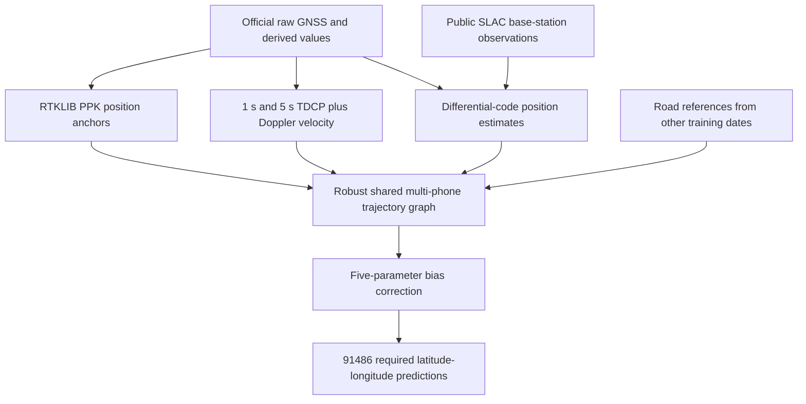

# Google Smartphone Decimeter Challenge 2021 — AutoSOTA research report

> Source-only GitHub archive prepared on November 9, 2026. This English text is retained from the supplied report. Historical paths and artifact-retention statements describe the original experiment environment. Data, checkpoints, fitted parameter files, predictions, logs, and raw evidence tables are external to this archive. No new experiment or Kaggle submission was run during integration.

> Compiled on 2026-10-23 from local configurations, logs, authenticated Kaggle submission records, and the official final standings. This update documents existing work; it does not restart experiments.

Starting from a publicly available RTKLIB processing chain, autosota combined a shared multi-phone trajectory, 1 s and 5 s time-differenced carrier-phase displacement estimates, base-station-corrected pseudorange positioning, road-geometry constraints, and date-grouped bias calibration. The resulting submission achieved a **Public Score of 2.53616 m and a Private Score of 1.12943 m**. Both scores belong to the same evaluated submission. Relative to Taro, the official 2021 winner, the Private Score is **30.26% lower**. The recorded work includes **13 advanced experiment families, 149 trajectory configurations, and 17 evaluated Kaggle submissions**.

These are post-competition **late submission** results. The competition's official final standings remain unchanged. A lower evaluated score, a complete reproduction of a competitor's solution, and an official winning rank are separate claims.

### 1. Task Definition and Competition Setting

#### 1.1 What is being estimated?

The [Google Smartphone Decimeter Challenge 2021](https://www.kaggle.com/competitions/google-smartphone-decimeter-challenge) asks participants to estimate smartphone positions from Android smartphone measurements. For each required `phone` and `millisSinceGpsEpoch` pair, a submission must predict latitude and longitude.

GNSS stands for Global Navigation Satellite System; GPS is one GNSS constellation. Smartphone measurements are affected by obstruction, multipath, measurement noise, carrier-phase cycle slips, clock discontinuities, and missing observations. A plausible overall route can still contain substantial local excursions or a persistent position offset. The objective is therefore to improve both typical horizontal accuracy and the upper tail of the error distribution.

The official Data description explicitly frames the challenge as a **post-processing** task, with lane-level mapping as an example. Future measurements along a route and information from neighboring phones may be used. autosota's solution is consequently an offline trajectory estimator, not a demonstrated real-time smartphone navigation system. See the [official Data page](https://www.kaggle.com/competitions/google-smartphone-decimeter-challenge/data) and the archived Data description (`research/official_data-description.txt`).

#### 1.2 Dataset, inputs, and submission format

| Item | Training set | Test set |
| --- | ---: | ---: |
| Drive collections | 29 | 19 |
| Phone trajectories | 73 | 48 |
| Required evaluation timestamps | 131,342 | 91,486 |
| Reference positions, or ground truth | Provided | Withheld for Kaggle evaluation |

The available inputs include:

- **Raw GNSS logs:** satellite observations, pseudorange rates, Doppler-related measurements, Accumulated Delta Range (ADR), signal strength, and measurement-status fields.
- **Derived GNSS values:** satellite positions, velocities, clock corrections, and related intermediate quantities in the `*_derived.csv` files.
- **Baseline locations:** estimated coordinates supplied by the hosts. The official Data description identifies these as estimates from a standard Weighted Least Squares (WLS) approach, rather than proprietary in-phone chipset locations.
- **Supplemental and publicly available reference data:** RINEX observations, SLAC base-station observations, and broadcast navigation files.
- **Inertial measurements:** accelerometer and gyroscope readings are available, but were not used in autosota's final evaluated solution.

The required columns are:

```csv
phone,millisSinceGpsEpoch,latDeg,lngDeg
```

`phone` identifies a collection–phone trajectory. In autosota's data handling it is constructed from `collectionName` and `phoneName`; it is not merely a phone-model category. `millisSinceGpsEpoch` is measured in milliseconds since the GPS epoch, and `latDeg`/`lngDeg` are WGS84 latitude/longitude in decimal degrees.

The official Evaluation page requires estimates for timestamps with at least four valid GNSS signals; these required keys are listed in `sample_submission.csv`. autosota's submission preserves all **91,486** required test keys, in sample-submission order. The order check is autosota's additional reproducibility convention, while complete coverage of the required keys follows the competition specification. See the archived Evaluation page (`research/official_Evaluation.txt`).

#### 1.3 Evaluation metric

For every `phone` at every required `millisSinceGpsEpoch`, Kaggle computes the **horizontal distance error in meters** between the predicted and ground-truth latitude/longitude. Within each phone trajectory, it calculates the 50th and 95th percentile errors, averages those two values, and then averages the result across all phones:

$$
\mathrm{Score}=\frac{1}{N}\sum_{i=1}^{N}\frac{P50(d_i)+P95(d_i)}{2}.
$$

Here, `d_i` is the collection of horizontal distance errors for phone trajectory `i`. **Lower is better.** The 95th percentile is an error threshold, not the mean error of the worst 5% of points. This score is also not the mean of all pointwise errors. Computing percentiles after pooling every phone's observations would implement a different metric.

The Public and Private leaderboards evaluate different test subsets. Official final ranks are determined by the Private leaderboard; the [official leaderboard](https://www.kaggle.com/competitions/google-smartphone-decimeter-challenge/leaderboard) states that its Private subset contains approximately 47% of the test data. autosota's local implementation and key-coverage checks are in [`scripts/metric.py`](scripts/metric.py).

### 2. Exploration and Reproduction Path

#### 2.1 Identify strong solutions and establish what can actually be reproduced

The investigation covered official standings, solution writeups, public Kaggle Notebooks, GitHub repositories and revisions, paper abstracts, and author-maintained posts. It also inspected 119 public discussion topics and the public comments on the winning and runner-up solution discussions.

| Solution investigated | Main idea | Work actually completed | Reproduction boundary |
| --- | --- | --- | --- |
| Taro, official 1st place | ADR-based relative motion, base-corrected pseudoranges, position/velocity factor graphs, and robust estimation | Reviewed the writeup and paper abstract; checked public repositories, Notebooks, comments, and subsequent code | The complete final 2021 pipeline was not found; no claim of a full reproduction |
| Wojtek Rosa, official 2nd place | XGBoost-based pseudorange-error correction, ADR trajectory estimation, and post-processing | Investigated the writeup, comments, and a public position-shift Notebook | Complete final code and model artifacts were not found |
| Ilya Elenik, official 3rd place | TensorFlow-based optimization of trajectory and clock variables using pseudorange, carrier, and motion constraints | Downloaded and pinned `GSDC_3rd`; built a Python 3.10 / TensorFlow 2.10 environment and checked core imports | The final export depends on missing artifacts such as `mymodel.hdf5`; the complete final result was not reproduced |
| Saito, a member of the official 5th-place team | Public optimization-based smoothing | Executed the original public component, adapted paths and compatibility settings, and submitted its output | This is an earlier public component, not the team's entire final solution |
| Everett / RTKLIB smartphone workflow | GNSS-log conversion to RINEX, PPK, and multi-phone fusion | Built the native Linux executable, processed all 121 phone trajectories, and evaluated author-released predictions as well as a raw-data replay | The complete chain ran, but recomputed PPK coordinates differ from the released intermediates; the two paths were evaluated separately |

The 10th-place Fkaneko repository was also downloaded and inspected. `taroz/gsdc2023` concerns a different competition edition and was used only as methodological reference material.

The practical outcome was a runnable, inspectable public positioning chain and independently evaluated baselines. Downloading a repository was not treated as evidence of reproducing its author's final leaderboard score.

#### 2.2 Evaluate public baselines before modifying them

| Baseline | Public Score | Private Score | Purpose |
| --- | ---: | ---: | --- |
| Author-released RTKLIB PPK predictions | 4.56668 | 2.15119 | Confirm the author's reported Private performance of approximately 2.15 and establish an optimization reference |
| Saito's original public smoothing component | 4.90680 | 3.37926 | Verify that the public Notebook component can execute locally and produce a valid submission |

autosota then ported the original Windows-oriented orchestration to Linux and processed **all 73 training and 48 test phone trajectories** from the official raw logs. Building the correct smartphone RTKLIB release requires the extra `rtkpos.c` and `rtklib.h` included in the release ZIP; the automatically generated Git-tag source archive alone is insufficient.

#### 2.3 Correct an unsuccessful multi-phone fusion strategy

An early prototype directly introduced unreliable individual-phone PPK positions into the joint estimator and obtained a Private Score of **3.73307**. Anchoring the estimator to robustly fused PPK positions instead improved the Private Score to **1.85765**.

This established that adding more phones is not sufficient by itself. Poor observations can propagate through a shared solution unless the fusion and outlier handling are appropriate.

#### 2.4 Add and evaluate complementary constraints

The subsequent experiments investigated road-normal constraints, joint road/trajectory optimization, carrier-phase robustness settings, directed road matching with heading continuity during stops, multi-lag TDCP, date-grouped bias correction, and independently computed base-corrected code positions.

The observed development sequence was:

- The first selected road-constrained solution reached a Private Score of **1.38761**.
- Directed road constraints with bias correction reached **1.34361**.
- Combined 1 s and 5 s TDCP with bias correction reached **1.31448**.
- Adding differential-code position factors, while retaining author-released PPK anchors, reached **Private 1.16530 / Public 2.54516**.
- Replaying that approach with locally recomputed raw-GNSS PPK anchors reached **Private 1.12943 / Public 2.54998**.
- Applying the bias correction according to actual road-factor coverage produced the final **Private 1.12943 / Public 2.53616**.

These are development-stage comparisons. Several stages changed more than one setting, so adjacent score differences are not presented as strict single-variable causal ablations.

#### 2.5 Negative results and the status of later exploration

| Direction | Recorded outcome |
| --- | --- |
| Add 10 s carrier-phase constraints to the 1 s/5 s combination | Calibration performance did not exceed the selected 1 s/5 s combination |
| Increase IRLS from 10 to 20 or 30 iterations | No consistent improvement |
| Further weaken PPK anchoring after introducing differential code | Some pre-correction calibration scores improved slightly, but bias-corrected OOF and reserved-date results worsened |
| Combine an in-graph bias prior with differential-code factors | Did not outperform the selected differential-code plus post-optimization bias correction |
| Conservative zero-velocity constraints, 12 configurations | Less than 0.002 m calibration improvement and no reserved-date improvement; not used to justify a submission |
| Slightly adjust carrier robustness | An evaluated candidate scored Private 1.15217 / Public 2.54398 and did not exceed the best submission |

The second exploration round on **2026-10-10** exported satellite-level differential-code observations and full covariance information for all 121 trajectories. Schur-eliminated satellite factors and covariance-aware position factors were implemented, and synthetic mathematical checks passed. **No real-trajectory configuration sweep or additional Kaggle submission was completed.** These preparatory changes were retained after the user requested that experiments stop; they are not credited with the final leaderboard result.

### 3. Final Successful Method

#### 3.1 Processing architecture

The final method combines accurate relative motion with complementary absolute-position information, then uses road geometry and a small bias-calibration model where appropriate.



Post-optimization bias correction is applied only to routes without active road constraints, avoiding an additional position shift on routes already anchored by the road prior.

#### 3.2 Shared multi-phone trajectory and robust optimization

For each drive collection, the estimator constructs a two-dimensional horizontal trajectory in a local East–North–Up (ENU) tangent frame, using east/north coordinates on a 1 s node grid. Interpolation aligns observations from different phones at their actual timestamps.

The joint solution includes PPK position anchors, TDCP displacements, Doppler velocities, an acceleration-smoothing regularizer, road-normal constraints, and differential-code position factors. Sparse linear systems are solved with iteratively reweighted estimation. RANSAC and multi-satellite consistency checks reject clearly inconsistent observations, while Huber weighting reduces the influence of remaining outliers.

#### 3.3 Combine 1 s and 5 s carrier-phase displacements

Time-Differenced Carrier Phase, or TDCP, uses changes in carrier measurements across epochs to estimate receiver displacement. The implementation handles raw/derived epoch alignment, satellite-clock changes, satellite orbital motion, and Earth rotation, while checking ADR validity and hardware-clock continuity.

The 1 s constraints preserve local trajectory structure; 5 s constraints provide longer-span motion information that limits accumulated drift. Doppler observations duplicated across lag caches are de-duplicated by timestamp. The two lag families are not statistically independent, and a complete temporal-correlation model is not claimed.

#### 3.4 Base-station-corrected code positions provide complementary absolute information

Public SLAC RINEX C1/C5 observations are combined with the satellite positions and velocities supplied in the official derived files. Processing includes interpolation, base/rover propagation-time differences, Earth rotation, and satellite-clock correction.

At each epoch, a robust WLS solution estimates a three-dimensional position correction and separate receiver-clock terms for different `signalType` groups. This measurement-processing stage reads no ground-truth positions and uses the Google baseline only as a linearization reference.

**The final trajectory graph incorporates the resulting position estimates. It does not directly optimize the individual satellite pseudorange residuals.** Direct satellite-level coupling was a later, unexecuted round-two direction. This distinction matters when describing the final method as opposed to proposed future work.

“Independently computed” refers to an additional processing path; PPK and differential-code positions still share some GNSS observations and are not statistically independent sensors.

#### 3.5 Direction-aware road-normal constraints

Road segments are constructed from the official training ground truth. Matching considers both distance and travel direction, with heading continuity through stops. The constraint primarily reduces cross-road deviation while allowing motion along the matched segment.

When predicting training drives, road references exclude the drive's own date and all reserved dates. Test predictions use references from the official training routes. No road constraint is forced where the reference geometry does not cover the route.

The last effective refinement replaced a city-name rule with an actual-coverage rule for bias correction. The test collection `2021-04-02-US-SJC-1` is at least approximately 1.3 km from the training downtown road references and has no active road factors. Allowing the bias correction on this uncovered route improved the Public Score from **2.54998 to 2.53616**, while the Private Score remained **1.12943**.

#### 3.6 Five-parameter bias calibration with date-grouped out-of-fold evaluation

The calibration model has five terms: global east and north offsets, offsets along and across the vehicle's direction of travel, and a timing-alignment term. It uses robust regression with regularization, equal total weight per phone trajectory, and a maximum correction magnitude of 3 m per prediction.

Leave-one-date-out evaluation within the non-urban calibration dates selects the robust scale, regularization, and shrinkage; final coefficients are then fitted using calibration dates only. In the differential-code calibration version anchored by author-released PPK, the non-urban score improved from **1.38984 m** before correction to **1.20580 m** out of fold. The final raw-data replay reused those calibrated coefficients. These are calibration-subset measurements, not Kaggle test scores.

Although the positioning method does not use a neural foundation model, this low-dimensional regression is fitted from training labels. Its parameters are empirical corrections; they do not by themselves establish a particular hardware fault.

#### 3.7 Selected settings

| Setting | Selected value |
| --- | --- |
| Trajectory node spacing | 1 s |
| PPK position-factor sigma parameter | 16 m |
| TDCP sigma / Huber parameters | 0.1 m / 0.05 m |
| Doppler sigma parameter | 0.5 m/s |
| Acceleration-smoothing sigma parameter | 1.5 |
| Differential-code position sigma floor | 10 m |
| Road-factor sigma parameter | 2 m |
| Road direction matching | Signed, with heading continuity during stops |
| IRLS iterations | 10 |
| Carrier-displacement caches | 1 s midpoint and 5 s lag5 |
| Bias-regression Huber / ridge / shrinkage | 0.5 / 1.0 / 1.0 |
| Maximum bias correction per prediction | 3 m |

These sigma values are weighting parameters used together with estimated observation uncertainty. They should not all be interpreted as measured physical sensor standard deviations. The full selected configuration is in `artifacts/replay_v2_pseudorange_raw_after_unmapped.json` (`artifacts/replay_v2_pseudorange_raw_after_unmapped.json`).

### 4. Performance and Comparison with the Top Three

#### 4.1 Comparison with the official top three by Private leaderboard rank

The following competitors are selected by the official final Private ranks. Each competitor's Public Score is also shown. All scores are in meters; lower is better.

| Official Private rank | Competitor / method | Public Score ↓ | Private Score ↓ | Official Public rank |
| --- | --- | --- | --- | --- |
| 1 | Taro | 2.86422 | 1.61938 | 2 |
| 2 | Wojtek Rosa | 3.15540 | 1.78079 | 5 |
| 3 | Ilya Elenik | 2.75339 | 1.82891 | 1 |
| Late submission | **autosota's final method** | **2.53616** | **1.12943** | Final standings unchanged |

Private ranks and scores were checked against the [official final leaderboard](https://www.kaggle.com/competitions/google-smartphone-decimeter-challenge/leaderboard). Public records were checked against the downloaded official Public leaderboard CSV (`research/leaderboard/google-smartphone-decimeter-challenge-publicleaderboard-2026-10-03T16-30-21.csv`). autosota cannot establish that every competitor's Public and Private records refer to the same prediction file. autosota's two scores explicitly refer to the same submission, **ID 56804334**.

Relative score reductions are calculated as `(competitor score − autosota's score) / competitor score`:

| Reference competitor | Public Score reduction | Private Score reduction |
| --- | --- | --- |
| Taro | 11.45% | 30.26% |
| Wojtek Rosa | 19.62% | 36.58% |
| Ilya Elenik | 7.89% | 38.25% |

#### 4.2 Comparison with the official Public leaderboard top three

The Public top three differ from the final Private top three. Both views are included to avoid confusing the official overall winner with the Public leaderboard leader.

| Official Public rank | Competitor / method | Public Score ↓ | Private Score ↓ | Official Private rank |
| --- | --- | --- | --- | --- |
| 1 | Ilya Elenik | 2.75339 | 1.82891 | 3 |
| 2 | Taro | 2.86422 | 1.61938 | 1 |
| 3 | From Indoor | 2.97233 | 2.17824 | 5 |
| Late submission | **autosota's final method** | **2.53616** | **1.12943** | Final standings unchanged |

Public ranks come from the same official Public CSV (`research/leaderboard/google-smartphone-decimeter-challenge-publicleaderboard-2026-10-03T16-30-21.csv`); the corresponding Private records were checked against the [official final standings](https://www.kaggle.com/competitions/google-smartphone-decimeter-challenge/leaderboard).

#### 4.3 Comparison with an explicitly reported post-competition result

Ilya Elenik's [3rd-place writeup](https://www.kaggle.com/competitions/google-smartphone-decimeter-challenge/writeups/3rd-place-solution) explicitly reports a later **Public Score of 2.59287 and Private Score of 1.39533**. autosota's **2.53616 / 1.12943** scores reduce these values by **2.19% / 19.06%**, respectively. The comparison result is the author's published report; it was not reproduced locally from the complete third-place pipeline.

#### 4.4 All 17 evaluated submissions

All times below are on **2026-10-04, China Standard Time (UTC+08:00)**. All listed submissions were recorded as `COMPLETE`.

| Time, UTC+08:00 | Submission ID | Prediction file | Public Score ↓ | Private Score ↓ |
| --- | --- | --- | --- | --- |
| 00:55:10 | 56802794 | `rtklib_author_reference.csv` | 4.56668 | 2.15119 |
| 00:59:01 | 56802853 | `saito_original_smoothing.csv` | 4.90680 | 3.37926 |
| 01:01:07 | 56802887 | `fgo_v1.csv` | 3.77206 | 3.73307 |
| 01:09:22 | 56803002 | `fgo_merged_v1.csv` | 3.89985 | 1.85765 |
| 01:11:25 | 56803036 | `fgo_road_selected.csv` | 3.00194 | 1.38761 |
| 01:20:48 | 56803195 | `fgo_raw_reproduced.csv` | 3.11346 | 1.39372 |
| 01:24:12 | 56803265 | `fgo_refined_selected.csv` | 2.71935 | 1.42354 |
| 01:42:23 | 56803550 | `v2_joint_road.csv` | 2.74190 | 1.40499 |
| 01:44:20 | 56803585 | `v2_joint_road_bias.csv` | 2.70199 | 1.35834 |
| 01:47:04 | 56803621 | `v2_combined_bias.csv` | 2.70255 | 1.34385 |
| 01:52:19 | 56803699 | `v2_directional_bias.csv` | 2.70259 | 1.34361 |
| 02:02:03 | 56803909 | `v2_lag5_bias.csv` | 2.61215 | 1.31448 |
| 02:09:21 | 56804067 | `v2_bias_prior.csv` | 2.61505 | 1.28449 |
| 02:10:21 | 56804095 | `v2_pseudorange_bias.csv` | 2.54516 | 1.16530 |
| 02:19:12 | 56804269 | `replay_v2_pseudorange_raw_after.csv` | 2.54998 | 1.12943 |
| 02:22:53 | 56804334 | `replay_v2_pseudorange_raw_after_unmapped.csv` | 2.53616 | 1.12943 |
| 02:26:35 | 56804398 | `replay_v2_convergence_raw_after_unmapped.csv` | 2.54398 | 1.15217 |

On 2026-10-23, an authenticated Kaggle API query reconfirmed that the best submission is `COMPLETE` with **Public 2.53616 / Private 1.12943**. The raw CLI response (`research/account_submissions_report_2026-10-23.raw.txt`) and parsed JSON (`research/account_submissions_report_2026-10-23.json`) are retained locally.

#### 4.5 Reserved-date development evaluation

| Method | Competition metric on the same reserved dates, m |
| --- | ---: |
| Official Google baseline | 6.717019 |
| Locally recomputed raw-data PPK | 5.422007 |
| Author-released PPK intermediates | 4.122916 |
| Final optimized raw-data pipeline | **1.691837** |

These are development-evaluation results, not Public or Private Scores. Per-phone results are retained in `artifacts/validation/` (`artifacts/validation/`).

### 5. Experimental Setup: Hardware, Time, Tokens, Models, and Software

#### 5.1 Available hardware versus resources actually used

| Item | Configuration or observation | Scope |
| --- | --- | --- |
| Server CPU | Intel Xeon Platinum 8358 at 2.60 GHz; 128 logical CPUs | Hardware inventory read on the report date |
| Available server GPUs | **4 × NVIDIA A100-SXM4-80GB** | Available hardware, not a four-GPU training run |
| GPUs used by the final positioning pipeline | **0** | RTKLIB, NumPy/SciPy, and sparse solves execute on CPU |
| Server memory | Approximately 1 TiB class | System capacity, not this case's peak memory consumption |
| Process parallelism | Commonly 8–12 workers; the final replay entry point defaults to 12 | Configurable process count, not exclusive allocation of all 128 logical CPUs |
| BLAS threads | Replay commands use `OPENBLAS_NUM_THREADS=1` | Limits thread oversubscription across worker processes |
| Historical peak utilization / GPU-hours | No telemetry retained | Not inferred from the current hardware inventory |

The report-day inventory agrees with the resource specification recorded earlier in the conversation, but is not a substitute for historical utilization telemetry. The evidence snapshot is `case_report_evidence_2026-10-23.json` (`research/case_report_evidence_2026-10-23.json`).

#### 5.2 Distinguish the positioning baseline from the autosota runtime

| Layer | Recorded setting |
| --- | --- |
| Pretrained foundation model for the positioning algorithm | **Not applicable.** The final method uses physical measurement models, numerical optimization, and low-dimensional regression, not neural pretraining or fine-tuning |
| Initial positioning baseline | RTKLIB `demo5 b34e_smartphone` with the release's extra source patches; Git checkout `188d93f331e04138d33aec8ef00b118dd7b256d5` |
| Research and implementation system | autosota research system for investigation, implementation, execution, and monitoring |
| Exact historical autosota runtime model ID, snapshot, and reasoning configuration | **Not recorded; cannot be reliably reconstructed** from the current session's identity |
| Model-training time | No large-model training took place; relevant costs are preprocessing, calibration, numerical solves, and the autosota workflow |

TensorFlow was installed to audit the third-place repository. That does not imply that the final method trained a TensorFlow model or ran GPU training.

#### 5.3 Time and token accounting

| Item | Recorded value | Coverage and limitations |
| --- | ---: | --- |
| Tracked main optimization goal duration | **3,928 s, approximately 65 min 28 s** | One platform-tracked workflow stage, not the entire project from scratch |
| Goal timestamps | 2026-10-04 01:32:49 to approximately 02:38:18, UTC+08:00 | Second-rounded timestamps can differ from the accumulated duration by about one second |
| `tokensUsed` for that same goal | **447,700 tokens** | Platform goal accounting, not a verified whole-project total or API invoice count |
| Input/output/cached/reasoning token breakdown | **Not recorded** | Insufficient for precise billing or context-use reconstruction |
| Whole-project token total and total autosota time | **Not fully recorded** | Earlier investigation, downloads, debugging, later recovery, and archiving are not necessarily included in the goal |
| Span of the 17 submission events | **Approximately 91 min 25 s** | 00:55:10–02:26:35; excludes preparation before the first submission |
| Sum of recorded per-configuration wall times for 149 advanced configurations | **534.82 s, approximately 8.91 min** | Timings after input caches were prepared; neither CPU core-seconds nor end-to-end project time |
| Recorded wall time per advanced configuration | **2.46–5.51 s** | Observed under that machine and cache state, not a general runtime guarantee |
| Cold-start download/build/raw-processing-to-submission duration | **No unified measurement retained** | Cached replay timings must not be presented as cold-start timings |

These timing scopes overlap and **must not be added to estimate total project time**. The original tracked-work-unit record is `goal_accounting_snapshot_2026-10-23.json` (`research/goal_accounting_snapshot_2026-10-23.json`). Per-configuration durations are the `seconds` fields in the saved `config_*.json` files.

#### 5.4 Software and pinned versions

| Environment | Main versions | Use |
| --- | --- | --- |
| `.venvs/kaggle` | Python 3.12.13; Kaggle CLI 2.2.4; NumPy 2.5.3; pandas 3.0.6; SciPy 1.18.1 | Main preprocessing, configuration search, trajectory optimization, and submission |
| `.venvs/ielenik` | Python 3.10.20; TensorFlow 2.10.1; Keras 2.10.0; NumPy 1.23.5; pandas 1.5.3; georinex 1.16.2 | Third-place dependency audit and base-station RINEX parsing |
| Native positioning executable | RTKLIB `rnx2rtkp`, built on Linux with GCC/gnu99 | Raw-data PPK recomputation |

Python interpreters are retained under `.runtime/python/`; exact dependency locks are in [`environments/`](environments/), and upstream commits are in `repository_manifest.json` (`research/repository_manifest.json`). The CLI reported a newer version on the report date, but this documentation update did not upgrade the experiment environment.

#### 5.5 Date grouping and configuration search

The fixed reserved dates are **2020-05-21, 2020-06-11, 2021-04-22, and 2021-04-15**, comprising five drive collections. All phones and drives from a date stay together. Training road references exclude both the current date and all reserved dates.

Trajectory settings are selected on the other calibration dates. Bias calibration performs leave-one-date-out evaluation within those calibration dates and tests 18 combinations of Huber scale, ridge regularization, and shrinkage.

| Family | Configurations | Best calibration score, m | Reserved-date score, m; before external bias correction |
| --- | --- | --- | --- |
| bias_prior | 8 | 1.329272 | 1.742865 |
| code_bias_prior | 12 | 1.305905 | 1.732482 |
| code_strength | 18 | 1.435200 | 1.870580 |
| combined | 15 | 1.643802 | 2.186321 |
| convergence | 9 | 1.449492 | 1.825095 |
| directional | 8 | 1.631163 | 1.989097 |
| joint_road | 10 | 1.686904 | 2.080558 |
| lag5 | 16 | 1.588887 | 2.012773 |
| midpoint | 8 | 1.630095 | 1.987655 |
| multiscale | 12 | 1.622870 | 1.995475 |
| pseudorange | 8 | 1.451902 | 1.830706 |
| reliability | 13 | 1.688040 | 2.025171 |
| stops | 12 | 1.450375 | 1.831247 |

The two error columns describe the family's calibration selection score and its selected configuration's reserved-date score before any external post-optimization bias correction. Some families already contain an in-graph bias prior, so they are not all identical-protocol, single-variable ablations.

The total of 149 counts only these 13 advanced trajectory families. Earlier trajectory, road, and extended grids, bias-regression searches, and failed pilots are separately retained. See `experiment_summary.csv` (`research/experiment_summary.csv`) and `artifacts/experiments/` (`artifacts/experiments/`).

### 6. Reproduction Commands, Artifacts, and Evidence

From the project root, replay the final method using existing GNSS intermediates:

```bash
OPENBLAS_NUM_THREADS=1 python run_best.py
```

Include native compilation and raw-preparation stages:

```bash
OPENBLAS_NUM_THREADS=1 python prepare_best.py --from-raw
OPENBLAS_NUM_THREADS=1 python run_best.py
```

`--prepare` reuses completed caches; it does not force every stage to recompute. All 121 original raw-processing chains were previously executed. Cold-start benchmarking would require isolated caches and separate timing. These commands generate predictions and do not submit them automatically.

| Artifact | Location or record |
| --- | --- |
| Best evaluated predictions | `replay_v2_pseudorange_raw_after_unmapped.csv` (`submissions/replay_v2_pseudorange_raw_after_unmapped.csv`) |
| Submission | ID `56804334`; Public `2.53616`; Private `1.12943` |
| SHA-256 | `cee19920d9bd5190debbe5fa692f7e6a8a3642d60419ca9c8eb2d0a086273cdb` |
| Selected parameters and trajectory diagnostics | `replay_v2_pseudorange_raw_after_unmapped.json` (`artifacts/replay_v2_pseudorange_raw_after_unmapped.json`) |
| All 17 evaluated submissions | `submission_ledger.csv` (`research/submission_ledger.csv`) |
| Acceptance checks | `acceptance.json` (`research/acceptance.json`) |
| Evidence collected for this case report | `case_report_evidence_2026-10-23.json` (`research/case_report_evidence_2026-10-23.json`) |
| Experiment records in this bundle | `experiments/INDEX.md` (`experiments/INDEX.md`): ideas, configurations, original logs, scores, and evidence index |

Replaying the author-PPK branch reproduced the evaluated coordinates to a maximum difference of approximately `4.97e-9 m`, below the 1 mm check tolerance. The final raw-data branch was checked for SHA-256 identity against its evaluated prediction file.

### 7. Interpretation and Limitations

1. **Lower scores than the official winner do not change the official rank.** The competition ended in 2021; these are 2026 late-submission evaluations.
2. **An unrestricted global-SOTA claim is not established.** Other participants' unshared post-competition submissions are inaccessible. The winning writeup also mentions a “Public 1.4 m” result without a corresponding record autosota could verify; autosota does not silently relabel it as Private.
3. **The full first- and second-place solutions were not reproduced.** The implemented improvements start from a runnable public workflow; the reproduction boundaries are documented above.
4. **The reserved dates are a repeatedly inspected development holdout.** Kaggle scores also informed development, and bias OOF is not a fully nested evaluation of the entire configuration search.
5. **Generalization remains limited by route coverage and dependence.** Training-road priors cover particular routes; phones in the same vehicle, adjacent epochs, and repeated routes are correlated. Treating every timestamp as an independent sample would overstate statistical evidence.
6. **Missing resource metadata remain missing.** The exact historical autosota runtime model, whole-project token total, and historical utilization telemetry are not replaced with current-session or current-machine assumptions.

The supported conclusion is that **a reproducible raw-GNSS RTKLIB workflow, augmented with multi-lag carrier information, differential-code positioning, direction-aware road priors, and low-dimensional bias calibration, achieved evaluated Public and Private improvements on this offline competition and lower corresponding scores than the official Private top three.**

### 8. Primary Sources

- [Official competition](https://www.kaggle.com/competitions/google-smartphone-decimeter-challenge), [Data](https://www.kaggle.com/competitions/google-smartphone-decimeter-challenge/data), and [Evaluation](https://www.kaggle.com/competitions/google-smartphone-decimeter-challenge/overview/evaluation) pages; the official Data and Evaluation text is also archived locally.
- [Official final leaderboard](https://www.kaggle.com/competitions/google-smartphone-decimeter-challenge/leaderboard), used to verify final Private ranks.
- [Taro's 1st-place writeup](https://www.kaggle.com/competitions/google-smartphone-decimeter-challenge/writeups/taro-1st-place-solution) and [winning paper abstract](https://www.ion.org/publications/abstract.cfm?articleID=18109), which reports final Public and Private scores of approximately 2.86 and 1.62.
- [Wojtek Rosa's 2nd-place writeup](https://www.kaggle.com/competitions/google-smartphone-decimeter-challenge/writeups/wojtek-rosa-2nd-place-solution).
- [Ilya Elenik's 3rd-place writeup](https://www.kaggle.com/competitions/google-smartphone-decimeter-challenge/writeups/3rd-place-solution) and [`GSDC_3rd`](https://github.com/ielenik/GSDC_3rd).
- [RTKLIB author workflow](https://rtklibexplorer.wordpress.com/2022/01/10/google-smartphone-decimeter-challenge/), [smartphone release](https://github.com/rtklibexplorer/RTKLIB/releases/tag/b34e_smartphone), and [open-access paper](https://pmc.ncbi.nlm.nih.gov/articles/PMC9144685/).
- [Saito's original public smoothing Notebook](https://www.kaggle.com/code/saitodevel01/gsdc-optimization-based-smoothing-1st-version).

Dataset citation: Fu, Guoyu (Michael), Khider, Mohammed, van Diggelen, Frank (2021, May). *Google Smartphone Decimeter Challenge*. Kaggle.
