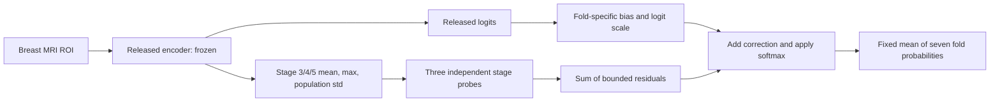

# ODELIA AutoSOTA research report

**Independent classification heads for frozen breast MRI encoders**

Source report prepared: August 25, 2026. Source package: version 0.1.1.
English Markdown archive published: October 10, 2026.

[Package overview and usage](../README.md) · [Complete search history](search_history.md) ·
[Full-precision results](../results/historical_metrics.json) · [Provenance](../provenance.json)

## Summary

AutoSOTA optimized the classification readout of seven released MeisenMeister
encoders for healthy, benign and malignant breast-ROI classification. The final
method freezes every encoder, trains a separate constrained head within each fold,
and averages the seven probability vectors with equal weights.

On the same 300 public-test ROIs, the released-model baseline achieved a Challenge
score of **0.876448** and the final heads achieved **0.899644**: an absolute increase
of **0.023196**, or approximately **2.65% relative to the baseline**. Micro-AUC rose
from **0.951011** to **0.963933**. All seven individual folds improved their Challenge
scores. This does not mean that every secondary metric improved.

**Evaluation scope:** this is a public-test-adaptive, same-cohort development result.
Public-test aggregate feedback guided the outer architecture and hyperparameter
search. In addition, several released encoder checkpoints may have been trained on
cases from this public-test cohort. Head training excludes those test cases, but
does not establish independence of upstream encoder training. These results are
not a new official hidden-test leaderboard score or an unbiased estimate of
performance on unseen patients.

## Contents

- [Task, data and evaluation](#task-data-and-evaluation)
- [Baseline reproduction](#baseline-reproduction)
- [Research trajectory](#research-trajectory)
- [Final method](#final-method)
- [Results](#results)
- [Compute and human involvement](#compute-and-human-involvement)
- [Reproduction and archive contents](#reproduction-and-archive-contents)
- [Limitations](#limitations)
- [References](#references)

## Task, data and evaluation

### Benchmark and inputs

The [ODELIA Breast MRI Challenge 2025](https://odelia2025.grand-challenge.org/)
is a MICCAI breast MRI classification benchmark. Each breast is assigned one
of three labels: `0=healthy/no lesion`, `1=benign`, or `2=malignant`.
The inputs are pre-contrast and the first two post-contrast DCE-MRI volumes.

The supplied report describes 741 examinations from six centers in five European
countries, with public partitions of 472 training, 119 validation and 150 test
cases. The centers are CAM, MHA, RSH, RUMC, UKA and UMCU. Across both breasts, the
reported class counts are 978 healthy, 195 benign and 309 malignant ROIs. The
multi-center setting provides variation in acquisition hardware and protocols.
Data access is through the [published challenge dataset](https://huggingface.co/datasets/ODELIA-AI/ODELIA-Challenge-2025).

### Adaptation partitions

| Partition | Examinations | Breast ROIs | Healthy | Benign | Malignant | Composition |
|---|---:|---:|---:|---:|---:|---|
| Training | 604 | 1,208 | 743 | 200 | 265 | 408 non-RSH ODELIA public-training cases + 196 AMBL cases |
| Validation | 103 | 206 | 130 | 28 | 48 | Non-RSH ODELIA public-validation cases |
| Fixed public test | 150 | 300 | — | — | — | Published Fold 0 test: 130 non-RSH + 20 RSH cases |

Both breasts of an examination remain in the same partition. The 80 RSH cases
from the public training/validation partitions are excluded from head adaptation.
The prepared pool contained 937 examinations (741 ODELIA + 196 AMBL), while only
the 604/103 training/validation cases above were used to train and select the heads.
Exact subject-membership files are external to this archive. Test class counts
were not enumerated in the source partition table.

Preprocessing follows the released `mmPlans.json`: foreground per-channel z-score
normalization, a 3 mm ROI margin, spacing `[2.0, 0.7, 0.7]`, and ROI shape
`[3, 128, 320, 320]`. The public-test cohort is different from the original
organizer-held regular and out-of-distribution evaluation cohorts.

### Metrics

The fixed evaluator flattens the three-class one-hot labels and predicted
probabilities into a micro-ROC calculation. The primary score is:

$$
S = \frac{\mathrm{MicroAUC} + \mathrm{Specificity}_{\mathrm{Sensitivity}=0.90}
    + \mathrm{Sensitivity}_{\mathrm{Specificity}=0.90}}{3}.
$$

The operating points use linear interpolation of the ROC curve, as implemented
in [metrics.py](../src/odelia_autosota/metrics.py). Additional metrics are macro
one-vs-rest AUC, balanced accuracy, macro F1, benign recall, malignant recall and
negative log-likelihood (NLL). NLL is lower-is-better; the other metrics are
higher-is-better. The final prediction is always the arithmetic mean of seven
probability vectors, with weights fixed at `1/7`.

## Baseline reproduction

### Released reference model

The reference is [MeisenMeister: A Simple Two Stage Pipeline for Breast Cancer
Classification on MRI](https://arxiv.org/abs/2510.27326), the winning solution
of the MICCAI 2025 ODELIA challenge. It uses BreastDivider to separate the breasts,
extracts high-resolution ROIs, and classifies each breast with a 3D encoder
initialized from MAMA-MIA segmentation pretraining.

The released encoder has six stages with channels `[32, 64, 128, 256, 320, 320]`.
Its original readout uses final-stage dropout, `AdaptiveAvgPool3d(1)` and
`Linear(320, 3)`. Seven released folds contribute to the probability ensemble.
The paper reports a five-center mean AUROC of 0.776 for its final regular-task
configuration. That result uses a different evaluation protocol and should not be
compared directly with the public-test scores in this report.

The unmodified upstream source is included at
[`third_party/meisenmeister`](../third_party/meisenmeister), pinned to commit
`a9b8ded20d59a7f6df8b03f24a6ec28d9d8ede0e`.

### Historical reproduction evidence

The source report records two distinct controls:

1. An early frozen-encoder, retrained linear-head control achieved validation
   Challenge score `0.768863700632`, with best epoch 27 and baseline commit
   `fd6b27b`. The report records two independent repetitions with identical
   report/checkpoint bytes and unchanged encoder fingerprints. This was an
   early search control, not the final seven-fold inference baseline.
2. The final comparison uses inference from all seven released checkpoints.
   Identity heads preserve the released outputs and their equal probability
   average gives public-test Challenge score `0.8764481481481482`.

The raw-image baseline run completed on August 3, 2026, using an A100 80 GB GPU,
all seven `best` checkpoints, and the released TTA and compilation defaults.
Public Parquet arrays were converted through the released int16 NumPy/TorchIO/NIfTI
route. Disjoint batches were merged into 150 unique examinations and 300 breast ROIs.

The BreastDivider plan requested `SimpleITKIOWithReorient`, which was absent from
the installed reader registry. An isolated runtime copy instead used
`NibabelIOWithReorient`; source data, checkpoint tensors and metric definitions
were retained. The recorded segmenter SHA-256 is
`18441fe5536ce9209d216f8a9ba6e6331c69f54a0acb3fa2fca6428214b92d18`.
See [baseline_reproduction.md](baseline_reproduction.md) for the full procedure.

This reproduces inference from the released models. It does not reconstruct the
original champion's training from scratch. The exact 2,000-epoch MAMA-MIA
ResEncUNetL `fold_all` initialization was unavailable in the audited public
segmentation weights. The competition container and original hidden cohorts were
also unavailable.

## Research trajectory

### Six formal phases

Each phase contains a local baseline and 32 candidate iterations. The first four
phases selected candidates with validation feedback; the last two used public-test
aggregate feedback. The control, architecture and selection protocol changed
between phases, so their scores do not form one directly comparable progression.

| Phase | Run | Selection metric | Starting score | Phase best | Main finding |
|---|---|---|---:|---:|---|
| Frozen encoder head V1 | `run_20260811_163638` | Validation Challenge score | 0.768864 | 0.802562 | Simple mean+max concatenation outperformed more complex pooling candidates |
| Round 2: structured heads | `run_20260812_081510` | Validation Challenge score | 0.802562 | 0.806752 | Hierarchical healthy-vs-lesion and benign-vs-malignant readouts |
| Seven-encoder head and fusion search | `run_20260813_064107` | Validation Challenge score | 0.834586 | 0.870629 | Composite heads, probability fusion and calibration |
| MOSAIC Gate V2 | `run_20260814_170203` | Validation Challenge score | 0.842775 | 0.860378 | Multi-scale bounded residuals, operating-point surrogates and cross-seed distillation |
| Test-Adaptive Gate V3 | `run_20260815_073408` | Public-test Challenge score | 0.876989 | 0.878922 | Small residuals, leave-one-out reliability and logit-space fusion |
| Independent per-fold heads | `run_20260817_060026` | Improved-fold count first, then public-test ensemble score | 0.876448 | 0.899644 | Independent internal adaptation within each fold, with a fixed final ensemble |

The [search-history appendix](search_history.md) retains all 198 integer-iteration
records, including failed ideas and feedback. It preserves the source numbering:
Round 2 has iterations 0–7 and 9–33 because iteration 8 is absent from the supplied
table. Raw search logs and working directories were not supplied in the release.

### Decisions in the final phase

| Iteration(s) | Feedback and response |
|---|---|
| 1–2 | A common affine correction improved only folds 3/4/6. Sequential banking retained useful fold changes and reverted regressions to identity. |
| 3 | A large residual reached ensemble score 0.914033, but four folds regressed. It was rejected under the per-fold objective. |
| 4–6 | Tiny bounded residuals or bias-only corrections improved six folds. Fold 0 remained sensitive to bias changes. |
| 7–15 | Stage probes and different bounds helped weaker folds 3/4. Iteration 9 fixed initialization variability using local seeds and deterministic linear maps. |
| 16–20 | Capacity and KL settings were explored separately for folds 2/5/6. |
| 21 | Removing bias from fold 0 first achieved improvements in all seven folds. |
| 22–23 | Score 0.900770 was rejected because fold 1 regressed. Restoring its bias-only head and retaining fold 6 bound 0.4 gave seven improved folds and score 0.897902. |
| 24–27 | Further bound changes for folds 3/6 did not improve the selected candidate. |
| 28–29 | Raising KL weight to 2.0 for folds 4 and then 3 produced the final score 0.899644. |
| 30–32 | Applying the same KL change to folds 2/6 reduced performance. Iteration 31 reproduced iteration 29; KL 1.5 in iteration 32 did not surpass it. |

The objective explains why the chosen method has a lower ensemble score than
some rejected candidates: the search required each fold to improve its own
Challenge score before maximizing the ensemble score.

## Final method

### Independent multi-scale readouts

For each fold, collect its own channel-wise spatial mean, maximum and population
standard deviation from encoder stages 3, 4 and 5. Stage channel counts of
256/320/320 give descriptor dimensions of 768/960/960, or 2,688 features in total.
There are no cross-fold features or shared head parameters.

The stage-probe path is used in folds 0/2/3/4/6. Folds 1/5 use only a bounded
class bias and bypass the descriptor/probe path. The diagram shows a single
fold's processing; every fold is adapted independently before averaging.

Each stage probe has `LayerNorm → Linear(16) → GELU → Linear(3)`, followed by
a bounded residual:

$$
r_{f,s} = B_f\tanh\left(\frac{W^{up}_{f,s}\,\mathrm{GELU}
 (W^{down}_{f,s}\,\mathrm{LN}(x_{f,s})+b^{down}_{f,s})+b^{up}_{f,s}}{B_f}\right).
$$

The corrected logits are:

$$
z_f^{new} = \exp(t_f)(z_f^{released}+b_f)+r_{f,3}+r_{f,4}+r_{f,5}.
$$

Output layers start at zero, biases at zero, and the logit scale at one, so
epoch zero returns the released model exactly. Bias-only heads use
`released_logits + bias`. The implementation calls `exp(t)` a temperature;
it multiplies logits directly, as shown above.

### Fold settings and training

| Fold | Head | Bias bound | Per-stage residual bound | KL weight | Logit scale |
|---:|---|---:|---:|---:|---|
| 0 | Stage probes | None | 0.25 | 1.0 | Fixed 1 |
| 1 | Bias only | 0.20 | — | 0 | Fixed 1 |
| 2 | Stage probes | 0.20 | 0.25 | 1.0 | Fixed 1 |
| 3 | Stage probes | 0.40 | 1.00 | 2.0 | Learned, bounded to [0.5, 1.5] |
| 4 | Stage probes | 0.40 | 1.50 | 2.0 | Learned, bounded to [0.5, 1.5] |
| 5 | Bias only | 0.20 | — | 0 | Fixed 1 |
| 6 | Stage probes | 0.20 | 0.40 | 1.0 | Fixed 1 |

Residual heads use cross-entropy plus an anchor to the released logits:

$$
L = \mathrm{CE}(z_f^{new},y) + \lambda_f\,mathrm{KL}
\left(\mathrm{softmax}(z_f^{released}/2)\;\|\;\mathrm{softmax}(z_f^{new}/2)\right).
$$

The historical KL implementation does not multiply the loss by temperature
squared. Bias-only heads use cross-entropy alone. All heads use AdamW with
learning rate `3e-4`, weight decay `1e-3`, batch size 128 and 300 epochs.
Residual-head learning rates follow cosine decay over exactly 3,000 optimizer
steps; bias-only learning rates remain constant.

Training seeds are `3107 + fold`. Probe initialization uses local generators;
elementwise linear maps preserve the historical numerical procedure. Each
fold's checkpoint is selected by maximum validation Challenge score, with lower
validation NLL breaking ties within `1e-12`. Epoch-zero identity is eligible.
Test labels are absent from the training archive and do not enter gradients.
The outer search nevertheless used aggregate public-test scores to choose these
architectures and hyperparameters.

The authoritative settings are in [heads.py](../src/odelia_autosota/heads.py);
[final_heads.json](../configs/final_heads.json) is a read-only audit mirror.

### Interpretation of the search findings

Mean, max and standard deviation may capture complementary global, localized
and heterogeneous responses. Multi-scale probes allow intermediate features to
contribute separately. Bounded residuals and KL anchoring limit departure from
a strong released classifier, while bias-only heads provide a smaller correction
for folds that did not benefit from larger probes.

The selected capacities differ substantially between folds. Fold 0 favored a
small residual without bias; fold 4 accepted a larger bound. The experiments
also showed that optimizing an ensemble alone can hide individual fold failures.
These are findings within this development cohort, not mechanisms or general
rules established on independent clinical data.

## Results

The final run is `run_20260817_060026`, with best iteration **29** and best source
commit `6e492c6c47628ce40e815a737d6113da6f326fa1`. The final historical source
commit is `83b4bce929d78b9f159736adc649ac30cf922e9e`. These identifiers refer to
the original experiment workspace, not commits in this AutoSOTA archive.

### Fixed public-test ensemble

Both columns use the same 300 breast ROI identifiers, labels, seven released
encoders, evaluator and equal-weight ensemble. Values below are rounded to
six decimal places; [historical_metrics.json](../results/historical_metrics.json)
retains the full precision.

| Metric | Released baseline | Final heads | Absolute change |
|---|---:|---:|---:|
| Challenge score | 0.876448 | 0.899644 | +0.023196 |
| Micro-AUC | 0.951011 | 0.963933 | +0.012922 |
| Specificity at 90% sensitivity | 0.841667 | 0.868333 | +0.026667 |
| Sensitivity at 90% specificity | 0.836667 | 0.866667 | +0.030000 |
| Macro OVR AUC | 0.931091 | 0.954975 | +0.023884 |
| Balanced accuracy | 0.675725 | 0.683102 | +0.007377 |
| Macro F1 | 0.710471 | 0.721422 | +0.010951 |
| Benign recall | 0.312500 | 0.312500 | +0.000000 |
| Malignant recall | 0.745763 | 0.762712 | +0.016949 |
| NLL (lower is better) | 0.429921 | 0.397167 | -0.032754 |

Benign recall remains unchanged at 0.312500. The improvement in the primary
micro-ROC score does not establish a comparable improvement for each class.

### Individual fold Challenge scores

| Fold | Released baseline | Final head | Absolute change |
|---:|---:|---:|---:|
| 0 | 0.822800 | 0.830644 | +0.007844 |
| 1 | 0.864072 | 0.873400 | +0.009328 |
| 2 | 0.866841 | 0.876046 | +0.009206 |
| 3 | 0.793035 | 0.799424 | +0.006389 |
| 4 | 0.799491 | 0.859806 | +0.060315 |
| 5 | 0.851578 | 0.863000 | +0.011422 |
| 6 | 0.873667 | 0.919952 | +0.046285 |

All seven folds improve Challenge score. Some secondary fold metrics regress;
the full per-fold metrics remain in the JSON evidence rather than being described
as uniformly improved.

### Validation ensemble and trade-offs

| Metric | Released baseline | Final heads | Absolute change |
|---|---:|---:|---:|
| Challenge score | 0.842685 | 0.844181 | +0.001496 |
| Micro-AUC | 0.918831 | 0.918465 | -0.000365 |
| Specificity at 90% sensitivity | 0.798544 | 0.808252 | +0.009709 |
| Sensitivity at 90% specificity | 0.810680 | 0.805825 | -0.004854 |
| Macro OVR AUC | 0.866028 | 0.861582 | -0.004446 |
| Balanced accuracy | 0.688477 | 0.659707 | -0.028770 |
| Macro F1 | 0.706301 | 0.673601 | -0.032700 |
| Benign recall | 0.428571 | 0.321429 | -0.107143 |
| Malignant recall | 0.729167 | 0.750000 | +0.020833 |
| NLL (lower is better) | 0.570782 | 0.559726 | -0.011056 |

Validation Challenge score rises only slightly. Validation Micro-AUC, macro AUC,
balanced accuracy, macro F1 and benign recall decrease, while NLL and malignant
recall improve. This mixed result is material when interpreting a method selected
using public-test feedback.

## Compute and human involvement

### Recorded experiment count and wall time

The supplied report counts six formal runs, 192 candidates, six iteration-zero
controls and six final verifications: **204 main records**. The appendix contains
the 198 integer-iteration rows; the six verification rows are not supplied there.
One additional interrupted baseline-only run is reported separately. Manual smoke
tests and diagnostic scripts outside the formal logs are not counted.

| Phase | Recorded wall time |
|---|---:|
| Frozen encoder head V1 | 1.67 h |
| Round 2 | 1.14 h |
| Seven-encoder head and fusion search | 3.85 h |
| MOSAIC Gate V2 | 5.40 h |
| Test-Adaptive Gate V3 | 4.73 h |
| Final independent per-fold heads | 5.01 h |
| Total | Approximately 21.8 h |

These durations were estimated from run-directory start times and final-report
timestamps in the source report. Each run used a single-GPU path. Thus 21.8 hours
is an upper bound on device time within those formal run windows, including LLM
planning, file inspection and waiting; it is not measured active GPU compute time.
Most later experiments trained small heads on cached frozen features. Earlier
preprocessing, feature extraction and unlogged diagnostics are excluded because
their timing was not available.

### API usage evidence

The report records 232 agent turns, 2,185,566 bytes of evaluation logs and 494,773
bytes of master prompts, totaling 2,680,339 bytes. A four-characters-per-token
heuristic gives roughly 0.67 million tokens of visible text; this is a text-size
estimate, not measured API token usage or a rigorous lower bound. Hidden inputs,
tool outputs, caching and provider billing records were not fully retained.

The logs recorded `$0.0000` because billable amounts were not returned to the CLI.
Actual token usage and monetary cost cannot be recovered from that value.

### Human direction

The source report estimates approximately ten interventions that changed the
research direction, protocol or run state; routine progress queries were excluded.
The documented directions included comparing against the same released-model
baseline, excluding test labels from gradient training, exploring frozen-encoder
readouts, requiring separate internal optimization within each fold, rejecting
shared post-ensemble gating, retaining all seven equally weighted folds, and
allowing aggregate public-test feedback for outer selection.

Within those constraints, AutoSOTA explored head architecture, residual bounds,
KL weights, bias, logit scale and their assignment to folds. The final per-fold run
also involved a storage-related stop and restart. The intervention count is an
estimate from the source report, not a formal event ledger supplied in this archive.

## Reproduction and archive contents

The archive contains the portable final-head toolkit, upstream reference source,
fold configuration, historical aggregate metrics, source/artifact hashes,
reproduction guides, tests and an artificial-data demonstration. All reports and
the search-history appendix are English Markdown. The method diagram above and
the numerical tables provide Markdown-native views of the supplied evidence.

Clinical images, labels, exact subject lists, cached descriptors, released weights,
final trained heads, raw AutoSOTA search workspaces and the original Word document
are not bundled. Exact historical cohort reproduction requires external artifacts,
not just matching the reported case counts.

Use the [package README](../README.md#installation-and-quick-start) for installation
and the full `pack → train → baseline/infer → evaluate` workflow. See
[data_formats.md](data_formats.md) for the NPZ and historical-cache contracts.
The training archive contains training/validation data only; evaluation labels
are kept in a separate archive and matched to prediction identifiers.

For exact historical inference, retain the original seven-fold TTA probabilities
and frozen descriptor archive. The legacy route uses
`log(clip(released_probability, 1e-8, 1))` as test logits. Unaugmented logits from a
new extraction are a different protocol and should not be presented as reproducing
the historical score exactly.

[provenance.json](../provenance.json) pins upstream code and Hugging Face revisions.
[historical_metrics.json](../results/historical_metrics.json) records the hashes of
seven training manifests, predictions, labels, descriptor data and the original
protected evaluator. [SHA256SUMS](../SHA256SUMS) covers the published source archive.
Hashes establish artifact identity, not sample independence or generalization.

Software checks and historical experiments have separate scopes; see
[release_validation.md](release_validation.md). Synthetic workflow scores are
software checks and are not clinical benchmark results.

## Limitations

1. **Public-test adaptation.** Aggregate test scores guided outer candidate
   selection. Validation-only checkpoint selection and exclusion of test-gradient
   training do not make that outer search blind.
2. **Possible encoder training overlap.** Released models used a collected
   937-examination pool and leave-one-source-out folds. Public-test cases may
   have been seen by several ensemble members; full per-checkpoint membership
   has not been independently established in this bundle.
3. **Incomplete external artifacts.** Exact cohort lists, caches and trained final
   heads are not supplied. The historical clinical run is not reproduced by the
   synthetic examples or current package checks.
4. **Different official protocol.** The original organizer-held hidden cohorts
   and competition container are unavailable. Official challenge scores and the
   local public-test scores are not directly interchangeable.
5. **Mixed secondary outcomes.** Validation and individual-fold submetrics have
   trade-offs, including reduced validation benign recall. No confidence intervals
   or statistical-significance results were supplied.
6. **Research scope.** No independent clinical deployment validation, patient-level
   lesion localization or verified attention/saliency results are claimed.

## References

- Benjamin Hamm, Yannick Kirchhoff, Maximilian Rokuss and Klaus Maier-Hein.
  [MeisenMeister: A Simple Two Stage Pipeline for Breast Cancer Classification on MRI](https://arxiv.org/abs/2510.27326).
- [MeisenMeister upstream repository](https://github.com/MIC-DKFZ/MeisenMeister)
  and [released model weights](https://huggingface.co/Bubenpo/MeisenMeister).
- [ODELIA Breast MRI Challenge 2025](https://odelia2025.grand-challenge.org/)
  and [published challenge dataset](https://huggingface.co/datasets/ODELIA-AI/ODELIA-Challenge-2025).
- [BreastDividerDataset](https://huggingface.co/datasets/Bubenpo/BreastDividerDataset)
  and [BreastDividerModel](https://huggingface.co/ykirchhoff/BreastDividerModel).
